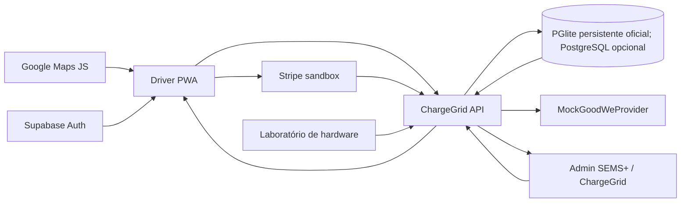
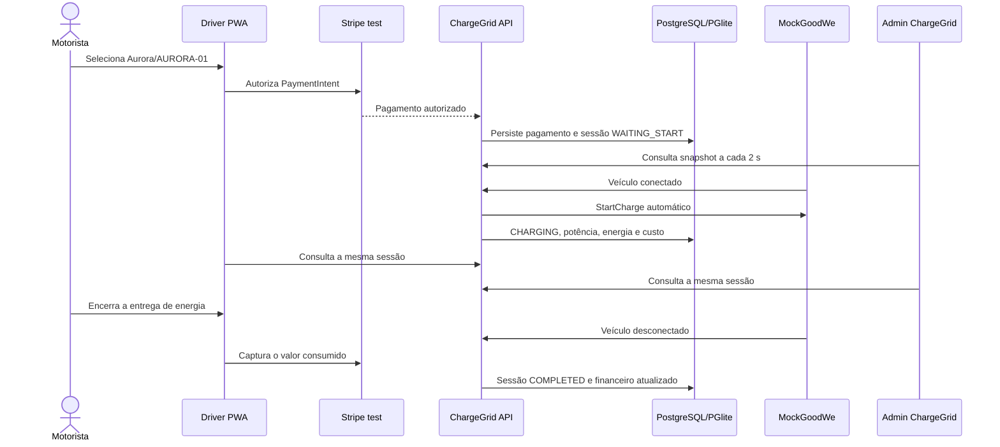

# ChargeGrid Intelligence — Sprint 4

Baseline funcional integrada do ChargeGrid Intelligence, continuação da [Sprint 2 — Dashboard Comercial ChargeGrid](https://github.com/PtiagoM/Dashboard_Comercial-ChargeGrid) e da Sprint 3. A Sprint 2 definiu produto e experiência; a Sprint 3 provou a primeira vertical comercial; a Sprint 4 consolida operação persistente, energia simulada e automação explicável. O registro histórico da Sprint 3 continua em [`docs/SPRINT3.md`](docs/SPRINT3.md).

O motorista descobre o Hub Solar Aurora, escolhe ou identifica um carregador, autoriza um pagamento Stripe em modo de teste e acompanha a recarga. A API mantém uma única sessão comercial persistida; Operação, Sessões, Fila e Resumo financeiro do Admin observam os mesmos registros. Somente a fronteira física GoodWe/HCA G2 é simulada.

Esta baseline não é um produto de produção. Ela prioriza comportamento coerente e demonstrável, separando integração real, sandbox e simulação. A ordem vigente e o que ainda falta para concluir as etapas estão em [`docs/specs/SPRINT4_EXECUTION_ORDER.md`](docs/specs/SPRINT4_EXECUTION_ORDER.md).

## Equipe e continuidade

Esta entrega consolida a Sprint 4, em continuidade ao [Dashboard Comercial ChargeGrid (Sprint 2)](https://github.com/PtiagoM/Dashboard_Comercial-ChargeGrid) e à prototipagem integrada da [Sprint 3](docs/SPRINT3.md).

| Equipe | RM |
| --- | --- |
| Tiago Pimentel Muniz | 574148 |
| Gustavo Curis de Francisco | 569704 |
| Caio César Portela França | 573127 |
| Lourenço Borges da Silva | 569515 |
| Davi Teodoro Novais | 571022 |

O objetivo é consolidar um protótipo operacional, com partes reais e simuladas claramente identificadas, no qual descoberta, pagamento, automação do carregador, medição energética e gestão comercial atuam sobre uma única sessão persistida.

> Leia [`docs/CURRENT_STATE.md`](docs/CURRENT_STATE.md) para o estado do repositório; [`docs/specs/sprint4/acceptance.md`](docs/specs/sprint4/acceptance.md) contém contratos, vetores e gates executados. Este README descreve a baseline S4-C1, não o pacote futuro `sprint4-finalization` (S4-C2).

## Arquitetura executável



- PWA e Admin são interfaces distintas sobre a mesma API e os mesmos registros.
- Polling de aproximadamente dois segundos apenas consulta; energia e custo avançam no relógio da API.
- O laboratório `/admin` emite eventos físicos sobre os carregadores persistidos. Conectar um veículo a uma sessão autorizada dispara `StartCharge` automaticamente; ele não cria pagamento, receita ou sessão fictícia.
- O botão **Reiniciar dados de teste** limpa sessões, pagamentos, fila, atribuições e telemetria do Aurora sem recriar o catálogo.
- O runtime mínimo oficial é um único processo Node da API usando PGlite persistente em `.local/commercial-db`; PostgreSQL/Supabase remoto é opcional. A configuração remota e suas migrations estão preparadas, mas não são pré-requisito nem estão comprovadas como aplicadas neste ambiente.

### Fluxo funcional integrado



## O que funciona

- catálogo compartilhado do Hub Solar Aurora e carregadores `AURORA-01` a `AURORA-06`;
- descoberta normal pela PWA, detalhe do local, QR e código operacional manual;
- Payment Element e PaymentIntent reais no Stripe test, com captura manual de cartão ao encerrar;
- uma sessão persistida e compartilhada entre PWA, API e Admin;
- ciclo físico `AVAILABLE → CONNECTED → CHARGING → AVAILABLE`;
- energia coerente (`potência × tempo`), custo pela tarifa congelada e teto financeiro;
- Admin ChargeGrid em Operação, Sessões, Fila e Resumo financeiro;
- fila persistida, uma entrada ativa por motorista, chamada FIFO por estabelecimento e atribuição temporária de dez minutos;
- atualização automática e recuperação após reload/reinício da API;
- estados de falha/offline e recuperação emitidos pelo laboratório GoodWe simulado.
- telemetria simulada da planta, cálculo coerente de fluxo/importação/exportação, admissão por demanda e insights determinísticos com evidências persistidas na API.

O dashboard agregado SEMS+ não é a fonte desses dados comerciais: seus gráficos/estimativas legados ainda não representam uma série integrada validada. Essa extensão e a previsão ficam planejadas para S4-C2, depois do Gate G7.

## Integrações e limites

| Camada | Classificação | Estado |
| --- | --- | --- |
| Driver PWA, Admin e API | Real no protótipo | React/Vite + Express; regras comerciais e de energia no backend |
| Stripe | Real em sandbox | PaymentIntent, Payment Element, autorização e captura de cartão validados |
| Supabase Auth | Real quando configurado | Identidade remota do motorista; sem configuração, o fallback local é somente de desenvolvimento |
| Google Maps | Real quando configurado | Fluxo e SDK preservados; exige `VITE_GOOGLE_MAPS_API_KEY` válida |
| Banco comercial | Real no protótipo | PGlite/PostgreSQL local persistente é o runtime oficial; não usa JSON. Um processo Node contínuo é necessário para relógio e lifecycle |
| Supabase PostgreSQL remoto | Opcional, preparado | Aplicação das migrations remotas não validada neste ambiente; não é dependência de execução local |
| GoodWe/HCA G2 | Simulado | Laboratório e `MockGoodWeProvider` substituem somente hardware/telemetria |
| Stripe live, GoodWe OpenAPI, HCA G2 físico, bateria e previsão ML | Conceitual/fora do escopo S4-C1 | Não estão implementados nem são apresentados como produtivos |

## Justificativa técnica

| Escolha | Motivo |
| --- | --- |
| Dois frontends React sobre uma API Express | Preserva as jornadas específicas de motorista e estabelecimento sem duplicar a regra comercial |
| Contratos TypeScript compartilhados | Mantém PWA, API e Admin alinhados nos mesmos estados, IDs e formatos |
| PGlite persistente + processo Node contínuo | Mantém banco relacional e relógio de domínio reproduzíveis sem exigir credenciais/cloud; PostgreSQL remoto pode substituir o adapter quando configurado |
| Stripe Payment Element em modo teste | Demonstra autorização e captura reais sem movimentar dinheiro nem simular aprovação financeira |
| Polling de 2 segundos | Entrega atualização automática estável para o protótipo, sem introduzir a complexidade de Realtime |
| `MockGoodWeProvider` | Substitui somente o hardware indisponível e mantém a fronteira preparada para um provider GoodWe futuro |

## Resultados quantitativos reproduzíveis

Os números abaixo vêm dos vetores e testes do backend (`S4-M4-U1`, `V08` e `V04`), não de telemetria física. A frequência amostrada é de 1 segundo; a consulta não avança o relógio nem interpola intervalos sem amostra.

| Entrada simulada | Intervalo | Resultado calculado/persistido | Evidência |
| --- | --- | --- | --- |
| PV 20 kW; carga-base 10 kW; EV 7 kW | 10 min confirmados | fluxo instantâneo: importação 0 kW/exportação 3 kW; EV 1.166,667 Wh; solar→EV 1.166,667 Wh; exportação 500 Wh | `repository.test.ts`, “persists balanced plant telemetry…” e `V08` |
| EV 5,5 kW; tarifa congelada 190 c/kWh | 1 h de carga confirmada | 5.500 Wh; custo 1.045 centavos (R$ 10,45); Stop confirmado zera potência | `repository.test.ts`, “applies simulated hardware events…” |
| PV 0 kW; base 8 kW; dois EV de 7 kW; limite 20 kW | admissão/corte | projeção sem controle 22 kW; bloqueio/corte determinístico pode reduzir carga observada para 15 kW, conforme prioridade e resposta do provider mock | `V08`; cenário analítico, não economia de fatura medida |

As asserções de telemetria usam `plant_aurora_001`, carregador/sessão persistidos no repositório em memória de teste, relógio injetado e timestamps de `2026-09-26T12:00:00Z` a `12:10:00Z`. Os dados da instalação local continuam no PGlite do usuário e não são incorporados a estes resultados. Uma validação manual anterior registrou sessão/captura Stripe test em [`docs/SPRINT3.md`](docs/SPRINT3.md); é evidência histórica separada dos vetores simulados.

Metodologia ambiental: não são publicados CO₂ evitado, equivalência de árvores, economia financeira ou bateria/SOC como resultados medidos. A baseline não possui fator ambiental/contrafactual certificado nem bateria. Valores apresentados em cenários de laboratório devem ser identificados como simulação.

## Estrutura

```text
apps/
  admin-web/       Admin SEMS+ com superfícies ChargeGrid e laboratório físico
  driver-pwa/      jornada mobile normal do motorista
  api/             pagamentos, sessões, fila, telemetria e persistência
packages/shared/   enums e contratos compartilhados
supabase/migrations/
  202609220001_commercial_core.sql
  202609220002_hardware_lifecycle.sql
  202609220003_commercial_queue.sql
docs/
  CURRENT_STATE.md
  SPRINT3.md
```

## Pré-requisitos

- Node.js 20 ou superior;
- npm 10 ou superior;
- chaves Stripe de teste para pagamento real em sandbox;
- chave Google Maps JavaScript API para exibir o mapa real;
- projeto Supabase para Auth, se o login remoto da PWA for demonstrado.

## Configuração

```bash
npm install
cp .env.example .env
```

Para o protótipo local, PGlite persiste sem credenciais ou variáveis obrigatórias adicionais. Preencha somente integrações usadas na demonstração, sempre localmente e sem versionar segredos:

- `VITE_CHARGEGRID_API_URL=http://localhost:3333`
- `VITE_GOOGLE_MAPS_API_KEY`
- `VITE_STRIPE_PUBLISHABLE_KEY`
- `STRIPE_SECRET_KEY`
- `STRIPE_WEBHOOK_SECRET` quando webhooks forem exercitados
- `VITE_SUPABASE_URL` e `VITE_SUPABASE_ANON_KEY` para Auth remoto
- `SUPABASE_URL` e `SUPABASE_ANON_KEY` no servidor para validar tokens remotos (ou as equivalentes `VITE_SUPABASE_URL` / `VITE_SUPABASE_ANON_KEY` já usadas pela PWA); `SUPABASE_SERVICE_ROLE_KEY` não é necessária para o runtime local e não deve ir ao browser
- `PORT` (padrão `3333`), `CHARGEGRID_ALLOWED_ORIGINS` (possui defaults localhost) e, opcionalmente, `CHARGEGRID_DATABASE_PATH` para escolher outra pasta PGlite
- `CHARGEGRID_DATABASE_URL` somente se optar pelo PostgreSQL remoto, com schema/migrations aplicados
- `VITE_CHARGEGRID_HARDWARE_LAB_ENABLED=true` para expor o laboratório em preview; em desenvolvimento Vite ele já fica disponível. A API usa `CHARGEGRID_HARDWARE_LAB_ENABLED=true` para habilitá-lo em produção
- `STRIPE_WEBHOOK_SECRET` apenas para exercitar webhooks; não é necessário para todos os percursos locais

O seed remoto é idempotente. O comando abaixo só é necessário se o grupo optar por configurar PostgreSQL/Supabase remoto; não faz parte do início local:

```bash
npx supabase login
npx supabase link --project-ref <project-ref>
npx supabase db push --include-seed
```

`supabase/seed.sql` é idempotente e preserva os IDs estáveis de `AURORA-01` a `AURORA-06`.

## Execução

No Windows, o modo recomendado com PGlite usa três terminais para que a API possa concluir seu shutdown antes dos frontends:

```bash
npm run dev:api
npm run dev:admin
npm run dev:pwa
```

Reinicie manualmente `dev:api` depois de alterar o código da API. O processo não usa watch porque reinícios forçados podem interromper uma escrita do PGlite.

O atalho abaixo continua disponível para iniciar tudo junto, mas não é o modo recomendado durante uma demonstração com dados locais importantes:

```bash
npm run dev
```

- Admin: `http://localhost:5173`
- Driver PWA: `http://localhost:5174`
- API/health: `http://localhost:3333/health`

O runtime local usa um único processo de API para `.local/commercial-db`. Ao finalizar, encerre Admin e PWA e, por último, pressione `Ctrl+C` uma vez no terminal da API; aguarde o log `API shutting down` antes de fechar a janela ou iniciar novamente. Se a API informar que o banco já está em uso, encerre a outra API; somente após confirmar que não há processo ativo, remova `.local/commercial-db.chargegrid-lock`. Nunca apague `.local/commercial-db`, pois ele contém as sessões e dados persistidos da demonstração.

Processos também podem ser iniciados separadamente com `npm run dev:admin`, `npm run dev:pwa` e `npm run dev:api`.

Contas demonstrativas do Admin:

- estabelecimento Aurora: `aurora@teste.com` / `teste`;
- Central GoodWe: `goodwe@teste.com` / `teste`.

Na PWA, crie uma conta de motorista ou use uma conta Supabase Auth já cadastrada. O cartão Stripe de teste recomendado é `4242 4242 4242 4242`, com validade futura e CVC de três dígitos.

## Jornada principal

1. No Laboratório de hardware, use **Reiniciar dados de teste**; depois abra o Admin com a conta Aurora em ChargeGrid → Operação.
2. Abra a PWA, use o mapa/detalhe do Hub Solar Aurora e escolha `AURORA-01`.
3. Aceite as condições e autorize o limite pelo Payment Element Stripe.
4. Confirme no Admin o mesmo carregador em espera e a mesma sessão.
5. No Admin, abra **Laboratório de hardware** e conecte o veículo; a API envia `StartCharge` automaticamente na potência escolhida.
6. Observe PWA, Operação e Sessões atualizarem automaticamente energia, potência e custo.
7. Encerre a energia na PWA, desconecte o veículo no laboratório e confirme a retirada/liquidação na PWA.
8. Confira a sessão concluída, o carregador disponível e o pagamento capturado no Resumo financeiro.

A jornada de fila é complementar. O roteiro atualizado de até cinco minutos e as evidências da Sprint 3 ficam em [`docs/SPRINT3.md`](docs/SPRINT3.md); a ordem de execução Sprint 4 está em [`docs/specs/SPRINT4_EXECUTION_ORDER.md`](docs/specs/SPRINT4_EXECUTION_ORDER.md).

## Qualidade

```bash
npm run lint
npm run typecheck
npm test
npm run build
npm run test:e2e:sprint4
```

O harness Sprint 4 usa banco e portas isolados; ele verifica contratos e jornadas com providers determinísticos de teste, não valida Stripe externo. A confirmação/captura real em sandbox e o mapa dependem das chaves externas e são gates manuais. A suíte ampla Admin pode ser executada com `npm run test:e2e` no gate final.

## Limitações conhecidas

- Google Maps exige chave válida, cota e restrições de origem compatíveis com o endereço usado na gravação;
- no estado documentado, migrations remotas não foram aplicadas; usar PGlite local como runtime oficial, ou preparar o remoto antes de optar por ele;
- Pix autoriza no Stripe test, mas o encerramento persistido após reembolso ainda não possui a mesma validação ponta a ponta do cartão;
- captura de cartão abaixo de R$ 0,50 permanece limitação conhecida e fora do escopo; o cenário demonstrativo deve consumir pelo menos R$ 0,50;
- não há GoodWe OpenAPI, HCA G2 físico, Stripe live, bateria, previsão ML, push remoto, RLS/IAM corporativo completo ou operação multi-instância;
- cards agregados do Dashboard e estimativas ambientais legadas SEMS+ não são métricas validadas da operação compartilhada S4-C1; previsão e integração canônica dos cards pertencem a S4-C2;
- o build do Admin mantém um aviso não bloqueante de chunk acima de 500 kB.

## Relação com energia e automação

O protótipo relaciona operação comercial e eficiência energética sem inventar integração física: a telemetria simulada define conexão, potência, falha e entrega; a API transforma potência e tempo em energia, deriva o custo pela tarifa aceita e mantém o teto autorizado. Essa fronteira permite substituir o mock por GoodWe real futuramente sem duplicar regras na PWA ou no Admin.

Na disciplina, a implementação evidencia integração de energia e operação com limites explícitos — não certificação ambiental nem controle industrial. Ela demonstra:

- **energia renovável e eficiência:** potência, tempo, energia entregue e custo são relacionados por medições coerentes e por um limite financeiro;
- **automação inteligente:** autorização financeira e conexão física válidas disparam `StartCharge` automaticamente;
- **integração de sistemas:** Maps, PWA, Stripe, API, banco, Admin e simulador GoodWe trocam dados por contratos explícitos;
- **coleta e visualização:** telemetria e eventos persistidos aparecem automaticamente nas interfaces do motorista e do estabelecimento;
- **decisão operacional:** disponibilidade, falha, ocupação e fila alteram o comportamento comercial usando o mesmo estado compartilhado.

## Roteiro de demonstração (até 5 minutos)

1. **0:00–0:30 — Problema e arquitetura:** explique a relação entre recarga comercial, energia da planta e controle de demanda; mostre PWA/Admin, API, PGlite e provider GoodWe simulado.
2. **0:30–1:30 — Descoberta e pagamento:** na PWA normal, encontre o Hub Solar Aurora no Maps, escolha `AURORA-01` e autorize o pagamento no Stripe test.
3. **1:30–2:20 — Operação integrada:** mostre a mesma sessão aguardando conexão em Operação/Sessões do Admin; no laboratório, conecte o veículo e observe o início automático.
4. **2:20–3:30 — Energia e automação:** ajuste o cenário simulado de PV/carga-base e explique fluxo, demanda, admissão e motivo da decisão usando os valores visíveis na API/Admin.
5. **3:30–4:20 — Encerramento:** encerre a sessão, confira energia/custo, recibo e o estado financeiro compartilhado; deixe claro que o hardware é simulado e o pagamento é sandbox.
6. **4:20–5:00 — Resultados e limites:** apresente os vetores quantitativos reproduzíveis desta página e diferencie cálculo simulado de medição física; não alegue bateria, CO₂ evitado ou economia de fatura.

A fila pode ser demonstrada como fluxo complementar se houver tempo; a atribuição de dez minutos não deve ser apresentada como reserva antecipada. O registro histórico da Sprint 3 está em [`docs/SPRINT3.md`](docs/SPRINT3.md). O vídeo da Sprint 4 deve usar a jornada normal, sem aplicação paralela.
