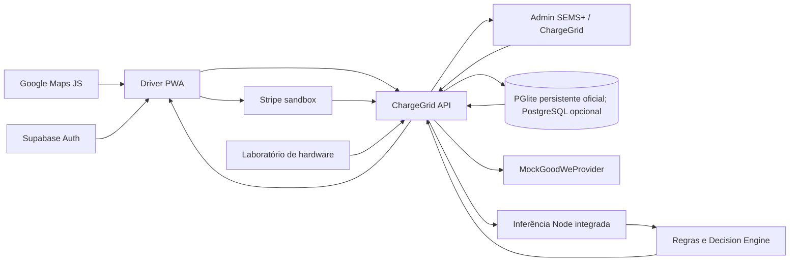
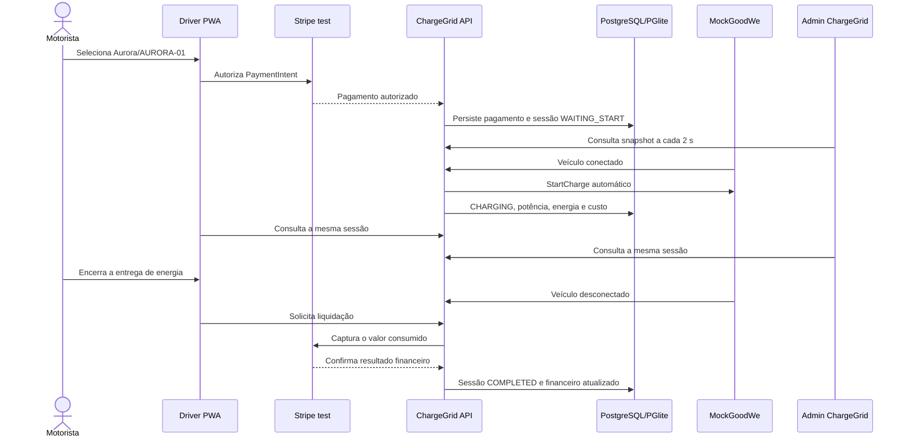
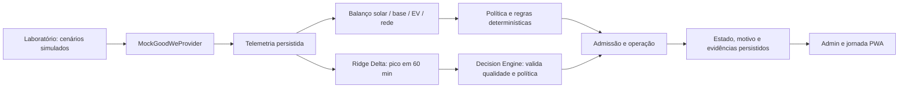

# ChargeGrid Intelligence — documentação técnica final

Entrega final da Sprint 4 · Projeto acadêmico do primeiro ano de Ciência da Computação · FIAP · 2026.

O **ChargeGrid Intelligence** conecta a jornada de recarga do motorista à gestão comercial e energética do estabelecimento. Foi desenvolvido no contexto do desafio GoodWe: transformar infraestrutura de energia e carregadores em um serviço de recarga com disponibilidade, pagamento, acompanhamento e decisões de demanda explicáveis.

O motorista descobre o Hub Solar Aurora, escolhe ou identifica um carregador, autoriza um pagamento Stripe em modo de teste e acompanha a recarga. A API mantém uma única sessão comercial persistida; Operação, Sessões, Fila e Resumo financeiro do Admin observam os mesmos registros. Somente a fronteira física GoodWe/HCA G2 é simulada.

O resultado é um protótipo acadêmico integrado: software executável, persistência relacional e pagamento em sandbox; hardware e telemetria GoodWe simulados. A documentação abaixo explica o projeto completo. O [roteiro técnico do vídeo](docs/delivery/SPRINT4_VIDEO_SCRIPT.md) acompanha a entrega com falas, navegação, tempo e conteúdo dos slides; a gravação final ainda deve ser produzida pela equipe.

**Guia de leitura:** execução local → contexto e público → solução e jornadas → arquitetura → energia e IA → evolução das sprints → resultados, qualidade e limites. As especificações históricas conservam decisões de etapas anteriores; este README e o [estado atual](docs/CURRENT_STATE.md) descrevem a entrega consolidada.

## Pré-requisitos

- Node.js 20 ou superior;
- npm 10 ou superior;
- chaves Stripe de teste para pagamento real em sandbox;
- chave Google Maps JavaScript API para exibir o mapa real;
- projeto Supabase para Auth, se o login remoto da PWA for demonstrado.

## Configuração

```bash
npm ci
Copy-Item .env.example .env
```

Para o protótipo local, PGlite persiste sem credenciais ou variáveis obrigatórias adicionais. Preencha somente integrações usadas na demonstração, sempre localmente e sem versionar segredos:

- `VITE_CHARGEGRID_API_URL=http://localhost:3333`
- `VITE_GOOGLE_MAPS_API_KEY`
- `VITE_STRIPE_PUBLISHABLE_KEY`
- `STRIPE_SECRET_KEY`
- `STRIPE_WEBHOOK_SECRET` quando webhooks forem exercitados
- `VITE_SUPABASE_URL` e `VITE_SUPABASE_ANON_KEY` para Auth remoto
- `SUPABASE_URL` e `SUPABASE_ANON_KEY` no servidor para validar tokens remotos (ou as equivalentes `VITE_SUPABASE_URL` / `VITE_SUPABASE_ANON_KEY` já usadas pela PWA); `SUPABASE_SERVICE_ROLE_KEY` não é necessária para o runtime local e não deve ir ao browser
- `PORT` (padrão `3333`), `CHARGEGRID_ALLOWED_ORIGINS` (possui defaults localhost) e, opcionalmente, `CHARGEGRID_DATABASE_PATH` para escolher outra pasta PGlite
- `CHARGEGRID_DATABASE_URL` somente se optar pelo PostgreSQL remoto, com schema/migrations aplicados
- `VITE_CHARGEGRID_HARDWARE_LAB_ENABLED=true` para expor o laboratório em preview; em desenvolvimento Vite ele já fica disponível. A API usa `CHARGEGRID_HARDWARE_LAB_ENABLED=true` para habilitá-lo em produção
- `STRIPE_WEBHOOK_SECRET` apenas para exercitar webhooks; não é necessário para todos os percursos locais

O seed remoto é idempotente. O comando abaixo só é necessário se o grupo optar por configurar PostgreSQL/Supabase remoto; não faz parte do início local:

```bash
npx supabase login
npx supabase link --project-ref <project-ref>
npx supabase db push --include-seed
```

`supabase/seed.sql` é idempotente e preserva os IDs estáveis de `AURORA-01` a `AURORA-06`.

## Execução

No Windows, o modo recomendado com PGlite usa três terminais para que a API possa concluir seu shutdown antes dos frontends:

```bash
npm run dev:api
npm run dev:admin
npm run dev:pwa
```

Reinicie manualmente `dev:api` depois de alterar o código da API. O processo não usa watch porque reinícios forçados podem interromper uma escrita do PGlite.

O atalho abaixo continua disponível para iniciar tudo junto, mas não é o modo recomendado durante uma demonstração com dados locais importantes:

```bash
npm run dev
```

- Admin: `http://localhost:5173`
- Driver PWA: `http://localhost:5174`
- API/health: `http://localhost:3333/health`

O runtime local usa um único processo de API para `.local/commercial-db`. Ao finalizar, encerre Admin e PWA e, por último, pressione `Ctrl+C` uma vez no terminal da API; aguarde o log `API shutting down` antes de fechar a janela ou iniciar novamente. Se a API informar que o banco já está em uso, encerre a outra API; somente após confirmar que não há processo ativo, remova `.local/commercial-db.chargegrid-lock`. Nunca apague `.local/commercial-db`, pois ele contém as sessões e dados persistidos da demonstração.

Processos também podem ser iniciados separadamente com `npm run dev:admin`, `npm run dev:pwa` e `npm run dev:api`.

Se a suíte completa da API terminar por falta de memória no Node 24, execute os testes do workspace API em arquivos focais, um por invocação, com `npm run test --workspace @chargegrid/api -- <arquivo-de-teste> --maxWorkers=1`. Isso não substitui o gate completo em um ambiente com memória suficiente; não remova o banco local para contornar OOM.

Contas demonstrativas do Admin:

- estabelecimento Aurora: `aurora@teste.com` / `teste`;
- Central GoodWe: `goodwe@teste.com` / `teste`.

Na PWA, crie uma conta de motorista ou use uma conta Supabase Auth já cadastrada. O cartão Stripe de teste recomendado é `4242 4242 4242 4242`, com validade futura e CVC de três dígitos.


## Vídeo da Sprint 3 (referência histórica)
Link: https://youtu.be/uPUDfY_bTtw

O vídeo acima registra a entrega anterior da Sprint 3. Para esta entrega, use o [roteiro da Sprint 4 — 4min50s e margem de 10s](docs/delivery/SPRINT4_VIDEO_SCRIPT.md).

## Equipe e continuidade

Esta entrega consolida a Sprint 4, em continuidade ao [Dashboard Comercial ChargeGrid (Sprint 2)](https://github.com/PtiagoM/Dashboard_Comercial-ChargeGrid) e à prototipagem integrada da [Sprint 3](docs/SPRINT3.md).

| Equipe | RM |
| --- | --- |
| Tiago Pimentel Muniz | 574148 |
| Gustavo Curis de Francisco | 569704 |
| Caio César Portela França | 573127 |
| Lourenço Borges da Silva | 569515 |
| Davi Teodoro Novais | 571022 |

O objetivo é consolidar um protótipo operacional, com partes reais e simuladas claramente identificadas, no qual descoberta, pagamento, automação do carregador, medição energética e gestão comercial atuam sobre uma única sessão persistida.

> Leia [`docs/CURRENT_STATE.md`](docs/CURRENT_STATE.md) para o estado do repositório; [`docs/specs/sprint4/acceptance.md`](docs/specs/sprint4/acceptance.md) contém contratos, vetores e gates executados. Esta baseline inclui o adendo de contrato S4-C2 e as unidades concluídas do pacote [`sprint4-finalization`](docs/specs/sprint4-finalization/spec.md).

## Contexto, público e problema

A GoodWe é a referência do desafio e do ecossistema energético considerado no projeto. A análise do grupo estudou o SEMS+ como interface de monitoramento de plantas, dispositivos, geração, consumo e registros técnicos de EV; SolarGo e o carregador HCA G2 também orientaram a delimitação do produto. Esse estudo é registrado no [mapeamento do SEMS+](docs/sems-analysis/README.md). A interface administrativa foi reconstruída em React com essa referência visual; o código entregue é uma aplicação própria, sem conexão oficial ao SEMS+.

O problema estudado surge quando a recarga passa do uso individual para um estabelecimento com vários motoristas: quem pode começar, qual carregador está disponível, quanto cobrar, como organizar a espera e como conciliar a carga dos veículos com o consumo do prédio e a geração solar? Monitorar um equipamento é uma parte da jornada; organizar a prestação desse serviço exige correlacionar identidade, sessão, energia e pagamento.

Essas são necessidades do cenário comercial analisado e diretrizes do desafio, e não uma alegação de defeitos ou ausência de recursos nos produtos GoodWe. O grupo concentrou a proposta em quatro frentes: controle de demanda, integração entre sistemas, tarifação/pagamento e inteligência aplicada à operação.

| Público | Necessidade | Resposta do projeto |
| --- | --- | --- |
| Motorista | Encontrar recarga, conhecer condições e acompanhar o gasto | PWA com mapa/código, checkout, sessão e comprovante |
| Estabelecimento/operador | Acompanhar equipamentos, atendimentos, espera e receita | Dashboard com Operação, Sessões, Fila, financeiro e Energia |
| GoodWe e canal de integradores, no conceito de produto | Acrescentar valor comercial à infraestrutura energética | Separação entre provider técnico e núcleo comercial; visão administrativa demonstrativa |

O Hub Solar Aurora é o estabelecimento de demonstração da vertical completa, com seis carregadores canônicos. Outros locais presentes no catálogo não representam seis novas integrações físicas nem operações comerciais completas homologadas.

## Solução, interfaces e jornadas

A solução reúne duas interfaces sobre um único núcleo comercial. O **Driver PWA** atende o motorista no navegador móvel; o **Dashboard Admin** atende a operação e a leitura energética. A camada de insights reúne previsão estatística, avaliação por regras e apresentação das evidências ao gestor. Não existe um assistente generativo tomando decisões elétricas.

| Interface | Uso na entrega |
| --- | --- |
| PWA | Descoberta por mapa ou código/QR, condições da oferta, autorização em sandbox, acompanhamento, encerramento e histórico/comprovante |
| Admin / Operação e Sessões | Mesmos IDs, estado físico e comercial, potência, energia e custo; detalhe da sessão e eventos |
| Admin / Fila e financeiro | Espera persistida, chamada e atribuição temporária; situação financeira vinculada à sessão |
| Admin / Energia e demanda | Solar, carga-base, EV, rede, política, motivo da decisão, previsão de pico e impacto nas sessões |
| Laboratório de hardware | Emissão controlada de conexão, falha, desconexão e cenários energéticos simulados sobre a API normal |

A jornada principal começa quando o motorista escolhe o Aurora e um carregador disponível. A API valida a oferta; o motorista aceita as condições e autoriza o limite no Stripe test. A sessão aguarda a conexão física simulada. Com pagamento e conexão válidos, o backend inicia a entrega e acumula energia/custo. O gestor observa a mesma sessão enquanto acompanha demanda e solar. Ao encerrar a energia, desconectar e liquidar, o motorista recebe o comprovante e o Admin vê o resultado financeiro correspondente.

Se não houver carregador elegível, a jornada complementar usa fila FIFO, com uma entrada ativa por motorista e atribuição temporária de dez minutos após a chamada. Essa atribuição não equivale a reserva antecipada. A política energética pode impedir novos inícios mesmo quando existe conector fisicamente livre.

## Arquitetura executável



- PWA e Admin são interfaces distintas sobre a mesma API e os mesmos registros.
- Polling de aproximadamente dois segundos apenas consulta; energia e custo avançam no relógio da API.
- O laboratório `/admin` emite eventos físicos sobre os carregadores persistidos. Conectar um veículo a uma sessão autorizada dispara `StartCharge` automaticamente; ele não cria pagamento, receita ou sessão fictícia.
- O botão **Reiniciar dados de teste** limpa sessões, pagamentos, fila, atribuições e telemetria do Aurora sem recriar o catálogo.
- O runtime mínimo oficial é um único processo Node da API usando PGlite persistente em `.local/commercial-db`; PostgreSQL/Supabase remoto é opcional. A configuração remota e suas migrations estão preparadas, mas não são pré-requisito nem estão comprovadas como aplicadas neste ambiente.

### Fluxo funcional integrado



## O que funciona

- catálogo compartilhado do Hub Solar Aurora e carregadores `AURORA-01` a `AURORA-06`;
- descoberta normal pela PWA, detalhe do local, QR e código operacional manual;
- Payment Element e PaymentIntent reais no Stripe test, com captura manual de cartão ao encerrar;
- uma sessão persistida e compartilhada entre PWA, API e Admin;
- ciclo físico `AVAILABLE → CONNECTED → CHARGING → AVAILABLE`;
- energia coerente (`potência × tempo`), custo pela tarifa congelada e teto financeiro;
- Admin ChargeGrid em Operação, Sessões, Fila e Resumo financeiro;
- fila persistida, uma entrada ativa por motorista, chamada FIFO por estabelecimento e atribuição temporária de dez minutos;
- atualização automática e recuperação após reload/reinício da API;
- estados de falha/offline e recuperação emitidos pelo laboratório GoodWe simulado.
- telemetria simulada da planta, cálculo coerente de fluxo/importação/exportação, admissão por demanda e insights determinísticos com evidências persistidas na API.

Os cards Monitoramento, Receita, Demanda e Utilização do Dashboard consultam `GET /commercial/dashboard-summary` com período UTC explícito. A série temporal não é fornecida: o card apresenta os agregados disponíveis e informa essa limitação, sem desenhar tendência sintética. Contribuições ambientais e Economia mostram energia persistida no período; CO₂, equivalências ambientais e economia de fatura ficam indisponíveis até haver fatores temporais e baseline tarifária documentados.

## Integrações e limites

| Camada | Classificação | Estado |
| --- | --- | --- |
| Driver PWA, Admin e API | Real no protótipo | React/Vite + Express; regras comerciais e de energia no backend |
| Stripe | Real em sandbox | PaymentIntent, Payment Element, autorização e captura de cartão validados |
| Supabase Auth | Real quando configurado | Identidade remota do motorista; sem configuração, o fallback local é somente de desenvolvimento |
| Google Maps | Real quando configurado | Fluxo e SDK preservados; exige `VITE_GOOGLE_MAPS_API_KEY` válida |
| Banco comercial | Real no protótipo | PGlite/PostgreSQL local persistente é o runtime oficial; não usa JSON. Um processo Node contínuo é necessário para relógio e lifecycle |
| Supabase PostgreSQL remoto | Opcional, preparado | Aplicação das migrations remotas não validada neste ambiente; não é dependência de execução local |
| GoodWe/HCA G2 | Simulado | Laboratório e `MockGoodWeProvider` substituem somente hardware/telemetria |
| Previsão de demanda no runtime | Inferência integrada; modelo/dados `SIMULATED_COMPOSITE` | Ridge Delta versionado é inferido pela API e fornece evidência complementar ao Decision Engine; não comanda hardware nem interrompe sessão ativa |
| Stripe live, GoodWe OpenAPI, HCA G2 físico, bateria e modelo treinado com telemetria Aurora | Conceitual/fora do escopo | Não implementados nem apresentados como produtivos |

## Justificativa técnica

| Escolha | Motivo |
| --- | --- |
| Dois frontends React sobre uma API Express | Preserva as jornadas específicas de motorista e estabelecimento sem duplicar a regra comercial |
| Contratos TypeScript compartilhados | Mantém PWA, API e Admin alinhados nos mesmos estados, IDs e formatos |
| PGlite persistente + processo Node contínuo | Mantém banco relacional e relógio de domínio reproduzíveis sem exigir credenciais/cloud; PostgreSQL remoto pode substituir o adapter quando configurado |
| Stripe Payment Element em modo teste | Demonstra autorização e captura reais sem movimentar dinheiro nem simular aprovação financeira |
| Polling de 2 segundos | Entrega atualização automática estável para o protótipo, sem introduzir a complexidade de Realtime |
| `MockGoodWeProvider` | Substitui somente o hardware indisponível e mantém a fronteira preparada para um provider GoodWe futuro |

### Camadas e comunicação

| Camada / localização | Responsabilidade e integração |
| --- | --- |
| `apps/driver-pwa` | React/TypeScript/Vite; jornada mobile, Maps, Auth e componente de pagamento; consulta/mutações comerciais via API |
| `apps/admin-web` | React/TypeScript/Vite; operação, gestão e insights; projeta snapshots e agregados comerciais recebidos do backend |
| `packages/shared` | Tipos, enums e DTOs compartilhados, incluindo contratos S4-C2 de energia, forecast e decisões |
| `apps/api/src/commercial` | Express e repositório comercial: ownership do motorista, oferta, sessão, fila, configuração, medição, projeções e persistência |
| `apps/api/src/payments` | Integração Stripe, autorização/captura e tratamento de confirmação; segredos permanecem no servidor |
| `apps/api/src/goodwe` | Provider simulado de sinais e comandos físicos; não cria receita ou autoriza pagamentos |
| `apps/api/src/ai` e `ml/forecasting` | Inferência Node do modelo versionado; preparação, treino e avaliação offline em Python |
| PGlite / migrations SQL | Registros relacionais persistidos no disco; adapter PostgreSQL remoto opcional |

A API é a fonte de verdade da operação comercial integrada do Aurora. Identidade do motorista é verificada no servidor; UUIDs e códigos públicos têm papéis distintos. A tarifa aceita é congelada na sessão, valores monetários usam centavos e energia usa Wh nos contratos. Mudar uma configuração para novas ofertas não reescreve o preço de uma sessão já aceita. Preferências de interface e superfícies demonstrativas fora dessa vertical não equivalem a persistência operacional.

O ciclo físico e o comercial são separados: um conector conectado não significa que o pagamento foi autorizado; terminar a entrega de energia não significa que a liquidação terminou. Comandos passam pelo provider e sua confirmação. Polling atualiza as telas, mas o processo contínuo da API mantém medição e lifecycle mesmo com o navegador fechado. Isso evita duas regras de negócio concorrentes nos frontends.

### Módulo de energia: do sinal à decisão

O laboratório aplica perfis como **Excedente solar**, **Rampa de demanda**, **Baixa geração solar**, **Perda de telemetria** e **Recuperação**. O provider produz sinais identificados como simulados; o backend persiste amostras, soma a carga dos EVs efetivamente em recarga e calcula o balanço sem adicionar bateria fictícia:

```text
carga total (kW) = carga-base + carga EV
importação (kW) = max(0, carga total − geração FV)
exportação (kW) = max(0, geração FV − carga total)
solar disponível para EV (kW) = min(carga EV, max(0, geração FV − carga-base))
energia (Wh) = potência (kW) × tempo confirmado (h) × 1.000
custo de energia (centavos) = energia (Wh) ÷ 1.000 × tarifa aceita (centavos/kWh)
```

A atribuição solar é um método de balanço que prioriza a carga-base; não rastreia fisicamente os elétrons de uma sessão. A API integra intervalos confirmados e expõe potência instantânea separada de energia acumulada. Taxa de ociosidade, quando aplicável após a tolerância de 15 minutos e conforme a política aceita, é separada do consumo energético.

O motor determinístico avalia importação, margem, frescor da telemetria e política vigente. Ele produz estado, motivo e ação de admissão; telemetria ausente/stale não vira leitura zero. O controle reativo de demanda e os comandos confirmados do provider são distintos da previsão: **o forecast pode bloquear novas admissões em risco crítico, mas não dispara parada de sessão ativa**. A recuperação considera a política persistida, incluindo estabilidade e limiar de retorno.



### Previsão de demanda — benchmark e runtime

O runtime Node carrega o artefato Ridge Delta, gera um forecast de pico de importação para os próximos 60 minutos e o entrega ao fluxo de regras/Decision Engine. A previsão não substitui a decisão determinística de admissão e não envia comandos ao carregador; risco crítico pode bloquear novos inícios, mas não interrompe sessões ativas. O modelo foi treinado e avaliado somente em dados compostos `SIMULATED_COMPOSITE`, montados de fontes independentes; portanto, os resultados abaixo são benchmark acadêmico e não desempenho validado no Hub Solar Aurora. Proveniência, protocolo, artefato, métricas completas e limites estão no [model card](docs/ai/model-card.md), na [decisão do dataset](docs/ai/dataset-decision.md) e no [protocolo de avaliação](docs/ai/evaluation-protocol.md).

No holdout temporal do benchmark, Ridge Delta obteve MAE 4,6151 kW, RMSE 8,1457 kW e F1 0,8461; o baseline Persistence obteve MAE 5,3225 kW, RMSE 9,7665 kW e F1 0,8144. A janela de teste é única e composta: não representa garantia de previsão em operação real.

O trabalho de IA tem duas etapas:

1. **Experimento offline:** composição de carga de edifício EULP/ComStock, sessões NREL Workplace Charging e geração NREL PVDAQ. As fontes não pertencem à mesma instalação. A série reúne 24.090 observações em intervalos de 15 minutos e 253 datas. Divisão cronológica por datas: 60% treino, 20% validação e 20% teste; janelas incompletas e cruzamentos entre partições são descartados. Python usa biblioteca padrão para os experimentos versionados, sem exigir Python para executar a aplicação.
2. **Inferência integrada:** a API carrega o JSON Ridge Delta validado por hash/schema, agrega histórico de telemetria e reproduz 17 features de lags, variação e calendário. O resultado é o **máximo estimado de importação na próxima hora**, um valor escalar; não uma curva futura a cada 15 minutos. Forecast, validade, origem, versão e motivo da decisão são persistidos e consumidos pelo Admin.

Ridge Delta prevê a diferença entre a importação atual e o pico futuro. A seleção usou validação, comparando candidatos e exigindo melhora de MAE/RMSE com limite de perda de F1; o teste foi consultado após congelar a seleção. MAE representa erro absoluto médio em kW; RMSE penaliza erros maiores; F1 resume a detecção de pico, não é “percentual de acerto” nem confiança da previsão atual.

O limiar de pico do benchmark (117,524661 kW) é estatístico. O Decision Engine compara o valor previsto com os limiares da **política do estabelecimento**, sem transformar esse número do dataset no limite elétrico do Aurora. Forecast expirado ou histórico insuficiente é explicitamente indisponível; a persistência usada como fallback fica identificada separadamente da IA. No laboratório, o aquecimento histórico também é simulado e deve ser declarado na demonstração.

Os dados compostos e a diferença entre calendário local das fontes e UTC do runtime limitam a validade externa. Para uso real, seriam necessários dados representativos da instalação, calibração e homologação técnica. O [guia do pipeline](ml/forecasting/README.md) explica reprodução e artefatos; o [model card](docs/ai/model-card.md) registra fontes e todas as rodadas.

## Evolução resumida das sprints

| Etapa | Contribuição e evidência | Como chega à entrega final |
| --- | --- | --- |
| Base inicial / Sprint 1 | [Modelagem de recargas](https://github.com/PtiagoM/Modelagem_Recarga_EV): gerador Python de 200 sessões sintéticas com semente 42, relações entre energia, duração, ocupação e cobrança | Fundamentação das variáveis e do problema. O repositório consultado não rotula a sprint no README; não é usado como prova de hardware nem como dataset do modelo final |
| Sprint 2 | [Dashboard Comercial ChargeGrid](https://github.com/PtiagoM/Dashboard_Comercial-ChargeGrid): frontend HTML/CSS/JS, dados JSON e recomendações determinísticas | Definição da experiência do gestor e do posicionamento complementar ao SEMS+; pagamento, backend e PWA ainda eram evoluções futuras |
| Sprint 3 | [Registro da prototipagem e integração](docs/SPRINT3.md): React/Admin, PWA, Stripe test, API e sessão compartilhada, lifecycle físico simulado, fila e recuperação | Base operacional completa reutilizada; evita apresentar checkout, sessão e fila como novidades da Sprint 4 |
| Sprint 4 | [Contratos e validação](docs/specs/sprint4/acceptance.md) e [consolidação final](docs/specs/sprint4-finalization/spec.md): cenários energéticos, balanço persistido, demanda, modelo avaliado/inferência, decisão e refinamentos das telas | Conecta a jornada existente à energia e à antecipação de risco com evidências; agrega resultados e limitações em uma documentação final |

As regras e ambições dos READMEs antigos são históricas: bateria, CO₂ e tarifas experimentais dessas etapas não passam automaticamente a ser capacidades implementadas aqui. A síntese usa os repositórios acima, o histórico Git e o código atual; não reproduz integralmente os relatórios das sprints.

## Resultados quantitativos reproduzíveis

Os números abaixo vêm dos vetores e testes do backend (`S4-M4-U1`, `V08` e `V04`), não de telemetria física. A frequência amostrada é de 1 segundo; a consulta não avança o relógio nem interpola intervalos sem amostra.

| Entrada simulada | Intervalo | Resultado calculado/persistido | Evidência |
| --- | --- | --- | --- |
| PV 20 kW; carga-base 10 kW; EV 7 kW | 10 min confirmados | fluxo instantâneo: importação 0 kW/exportação 3 kW; EV 1.166,667 Wh; solar→EV 1.166,667 Wh; exportação 500 Wh | `repository.test.ts`, “persists balanced plant telemetry…” e `V08` |
| EV 5,5 kW; tarifa congelada 190 c/kWh | 1 h de carga confirmada | 5.500 Wh; custo 1.045 centavos (R$ 10,45); Stop confirmado zera potência | `repository.test.ts`, “applies simulated hardware events…” |
| PV 0 kW; base 8 kW; dois EV de 7 kW; limite 20 kW | admissão/corte | projeção sem controle 22 kW; bloqueio/corte determinístico pode reduzir carga observada para 15 kW, conforme prioridade e resposta do provider mock | `V08`; cenário analítico, não economia de fatura medida |

As asserções de telemetria usam `plant_aurora_001`, carregador/sessão persistidos no repositório em memória de teste, relógio injetado e timestamps de `2026-09-26T12:00:00Z` a `12:10:00Z`. Os dados da instalação local continuam no PGlite do usuário e não são incorporados a estes resultados. Uma validação manual anterior registrou sessão/captura Stripe test em [`docs/SPRINT3.md`](docs/SPRINT3.md); é evidência histórica separada dos vetores simulados.

Metodologia ambiental: a energia solar destinada a EV e a energia entregue/exportada são agregados persistidos da API. Não são publicados CO₂ evitado, equivalência de árvores, economia financeira ou bateria/SOC como resultados medidos; consulte [`docs/dashboard-sustainability-methodology.md`](docs/dashboard-sustainability-methodology.md) para fontes, fórmula candidata e dados ainda ausentes. Valores apresentados em cenários de laboratório devem ser identificados como simulação.

## Estrutura

```text
apps/
  admin-web/       Admin SEMS+ com superfícies ChargeGrid e laboratório físico
  driver-pwa/      jornada mobile normal do motorista
  api/             pagamentos, sessões, fila, telemetria e persistência
packages/shared/   enums e contratos compartilhados
supabase/migrations/
  202609220001_commercial_core.sql
  202609220002_hardware_lifecycle.sql
  202609220003_commercial_queue.sql
docs/
  CURRENT_STATE.md
  SPRINT3.md
```

## Jornada principal

1. No Laboratório de hardware, use **Reiniciar dados de teste**; depois abra o Admin com a conta Aurora em ChargeGrid → Operação.
2. Abra a PWA, use o mapa/detalhe do Hub Solar Aurora e escolha `AURORA-01`.
3. Aceite as condições e autorize o limite pelo Payment Element Stripe.
4. Confirme no Admin o mesmo carregador em espera e a mesma sessão.
5. No Admin, abra **Laboratório de hardware** e conecte o veículo; a API envia `StartCharge` automaticamente na potência escolhida.
6. Observe PWA, Operação e Sessões atualizarem automaticamente energia, potência e custo.
7. Encerre a energia na PWA, desconecte o veículo no laboratório e confirme a retirada/liquidação na PWA.
8. Confira a sessão concluída, o carregador disponível e o pagamento capturado no Resumo financeiro.

A jornada de fila é complementar. As evidências da Sprint 3 ficam em [`docs/SPRINT3.md`](docs/SPRINT3.md); a [matriz de comportamento da Sprint 4](docs/SPRINT4_BEHAVIOR_MATRIX.md), [estado atual](docs/CURRENT_STATE.md) e [ordem de execução](docs/specs/SPRINT4_EXECUTION_ORDER.md) registram o estado consolidado.

## Qualidade

```bash
npm run lint
npm run typecheck
npm test
npm run build
npm run test:e2e:sprint4
```

O harness Sprint 4 usa banco e portas isolados; ele verifica contratos e jornadas com providers determinísticos de teste, não valida Stripe externo. A confirmação/captura real em sandbox e o mapa dependem das chaves externas e são gates manuais. A suíte ampla Admin pode ser executada com `npm run test:e2e` no gate final.

## Limitações conhecidas

- Google Maps exige chave válida, cota e restrições de origem compatíveis com o endereço usado na gravação;
- no estado documentado, migrations remotas não foram aplicadas; usar PGlite local como runtime oficial, ou preparar o remoto antes de optar por ele;
- Pix autoriza no Stripe test, mas o encerramento persistido após reembolso ainda não possui a mesma validação ponta a ponta do cartão;
- captura de cartão abaixo de R$ 0,50 permanece limitação conhecida e fora do escopo; o cenário demonstrativo deve consumir pelo menos R$ 0,50;
- não há GoodWe OpenAPI, HCA G2 físico, Stripe live, bateria, modelo treinado/validado com telemetria do Aurora, push remoto, RLS/IAM corporativo completo ou operação multi-instância; o forecast atual depende de telemetria simulada e do benchmark `SIMULATED_COMPOSITE`;
- cards comerciais do Dashboard usam o agregado compartilhado S4-C2; não há série temporal e impactos ambientais/econômicos sem método permanecem indisponíveis;
- o build do Admin mantém um aviso não bloqueante de chunk acima de 500 kB.

## Relação com energia e automação

O protótipo relaciona operação comercial e eficiência energética sem inventar integração física: a telemetria simulada define conexão, potência, falha e entrega; a API transforma potência e tempo em energia, deriva o custo pela tarifa aceita e mantém o teto autorizado. Essa fronteira permite substituir o mock por GoodWe real futuramente sem duplicar regras na PWA ou no Admin.

Na disciplina, a implementação evidencia integração de energia e operação com limites explícitos — não certificação ambiental nem controle industrial. Ela demonstra:

- **energia renovável e eficiência:** potência, tempo, energia entregue e custo são relacionados por medições coerentes e por um limite financeiro;
- **automação inteligente:** autorização financeira e conexão física válidas disparam `StartCharge` automaticamente;
- **integração de sistemas:** Maps, PWA, Stripe, API, banco, Admin e simulador GoodWe trocam dados por contratos explícitos;
- **coleta e visualização:** telemetria e eventos persistidos aparecem automaticamente nas interfaces do motorista e do estabelecimento;
- **decisão operacional:** disponibilidade, falha, ocupação e fila alteram o comportamento comercial usando o mesmo estado compartilhado.

## Vídeo técnico da entrega final

O [roteiro completo de 4min50s](docs/delivery/SPRINT4_VIDEO_SCRIPT.md) contém preparação, sequência de cliques, falas, evidências esperadas e conteúdo dos quatro slides. Alterna a jornada do motorista e a do gestor, com foco no módulo energético, na previsão e na decisão da Sprint 4. As quatro artes finais estão em PNG 1920 × 1080 (16:9): [problema e proposta](docs/delivery/slides-sprint4/slide-1.png), [arquitetura integrada](docs/delivery/slides-sprint4/slide-2.png), [IA e demanda](docs/delivery/slides-sprint4/slide-3.png) e [entrega e limites](docs/delivery/slides-sprint4/slide-4.png). O vídeo histórico da Sprint 3 não substitui essa entrega; a gravação ainda deve ser produzida pela equipe.
