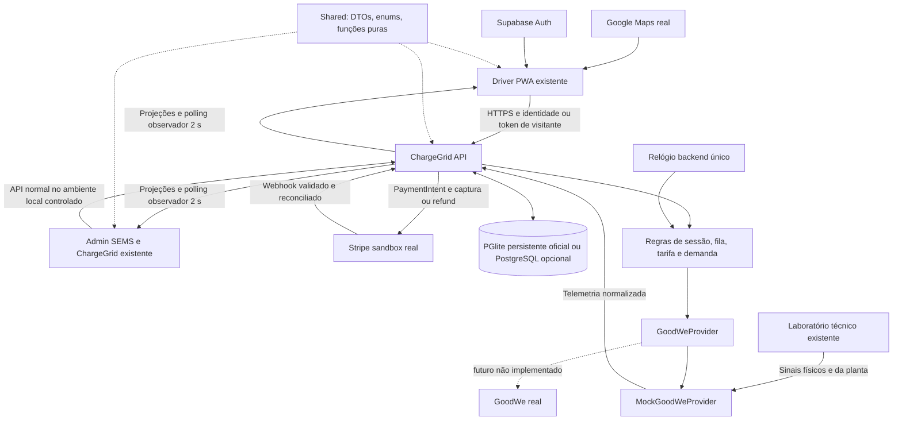

# 1. ESTADO ATUAL DO PROJETO

**ChargeGrid Intelligence — Sprint 4: solução final integrada e inovadora GoodWe.**

**Data:** 24/09/2026; atualização de execução: 30/09/2026. **Status:** plano original aprovado; M0–M6 e M7-U1 concluídos; M7-U2/G7 pendentes. A execução vigente segue a [ordem canônica](specs/SPRINT4_EXECUTION_ORDER.md): terminar M7 deste plano antes de iniciar `sprint4-finalization`.

**Atualização de escopo aprovada:** D1–D4 e o recorte adicional do responsável, registrados na seção 13, substituem as propostas anteriores correspondentes. O núcleo obrigatório é **operação comercial completa + experiência do motorista + energia da planta + controle de demanda + automação explicável + integração final**, no Aurora. Aprovação dessas decisões não é autorização para implementar os marcos. Os achados e resultados abaixo continuam retratando o código auditado, não as mudanças planejadas.

**Desdobramento SDD:** [especificações executáveis](specs/sprint4/spec.md), com contrato comum, decisões técnicas, unidades M0–M7 e critérios verificáveis. G0–G6 estão concluídos; M5-U1 isolou o ambiente E2E; U2A validou sessão/persistência; U2B validou fila, tarifas e CSV; U2C validou energia, encerramento e recuperação; U3 foi confirmado manualmente pelo responsável com Maps real e Stripe sandbox. M6-U1/U2 e G6 foram concluídos; M7-U1 consolidou README, estado, ordem e evidências. G7 permanece aberto e pertence a M7-U2.

**Conclusão:** a Sprint 3 entregou uma vertical comercial real e persistente para o Aurora. O projeto ainda não é um produto final integrado: boa parte do Admin continua usando regras e registros locais; a PWA mistura catálogo remoto com fixtures e guarda histórico/comprovantes no navegador; energia, demanda e inteligência ainda não controlam essa mesma operação. A Sprint 4 deve conectar e corrigir essas capacidades, não redesenhar as telas nem reconstruir a stack.

## Base e método

- Branch examinada: `feature/admin-sprint3-integration`, HEAD `a767f79`; working tree inicialmente limpo.
- Referência remota local conhecida: dois commits à frente (`23e213f`, `7d5c6de`), alterando somente três linhas do README para incluir o vídeo da Sprint 3. Não houve pull, merge, push ou troca de branch. A comparação não é um fetch recente do servidor.
- Código, migrations, contratos, testes, rotas e mutações foram confrontados com os documentos. Comentários, diretórios README e telas existentes não foram tratados como features executáveis.
- Aplicações executadas: Admin `localhost:5173`, PWA `localhost:5174`, API `localhost:3333`.
- Validação visual efetiva em navegador: Admin com Central GoodWe e Gestora Aurora; PWA pública e com perfil local descartável de inspeção; laboratório somente observado. Screenshots foram abertos e examinados. Limites e evidências estão na matriz.
- Não foram criados pagamentos, usuários remotos, sessões, entradas na fila, comandos físicos ou resets para esta análise. O perfil local da PWA permitiu examinar UI protegida, mas não constitui teste de autenticação Supabase.

## O que funciona de fato

- React/Vite Admin e Driver PWA, Express/TypeScript API, contratos compartilhados e SQL comercial.
- Banco PGlite persistente; adapter PostgreSQL remoto existente.
- Catálogo Aurora com seis carregadores estáveis, codes e QR, a mesma operação consultada por PWA/Admin/laboratório.
- PaymentIntent Stripe real em teste; cartão com autorização e captura; integração Pix e refund presentes, porém seu fechamento comercial está incompleto.
- Sessão criada pela API, pagamento vinculado, espera de conexão, início automático no caminho pagamento → CONNECT, medição simulada no backend, encerramento e captura no caminho normal suportado.
- Fila persistida, uma entrada ativa por motorista, chamada ao liberar equipamento; atualização por polling de aproximadamente dois segundos.
- Laboratório emite eventos físicos na mesma API; reset preserva catálogo.
- Google Maps real existe e chegou a renderizar tiles na inspeção. Houve também períodos de loading e falha transitória de consulta. O console confirmou **cota diária da chave Maps Demo esgotada** e um erro de `IntersectionObserver`; estabilidade ainda precisa de gate específico. Separadamente, o código recria a instância quando o polling troca `places`.

## O que a evidência não permite afirmar

- Não há provider GoodWe real nem hardware HCA G2 conectado.
- Não há prova atual de banco comercial Supabase remoto funcionando neste ambiente. `CHARGEGRID_DATABASE_URL` não está configurada; URL/chaves de Auth não equivalem a conexão SQL comercial.
- Não há controle de demanda backend, tarifa dinâmica integrada, ociosidade persistida, recomendações operacionais compartilhadas ou histórico PWA recuperável em outro dispositivo.
- Aprovação do comando mock não equivale a confirmação de equipamento real. Pastas `demand`, `idleness`, `ai`, `reports`, `auth` etc. com README não são serviços implementados.
- Passar 98 testes não prova a jornada completa: muitos testes protegem regras locais ou usam Stripe mockado.

## Evidência quantitativa existente, não criada para o relatório

A consulta somente leitura encontrou um estabelecimento persistido, seis carregadores `CONNECTED/OCCUPIED`, uma sessão `COMPLETED`, uma entrada de fila e energia de **282,931 Wh**, com custo de **54 centavos**. O Admin apresentou aproximadamente **0,283 kWh**, autorização de **R$ 25,00** e captura de **R$ 0,54**, com PaymentIntent vinculado. São registros preexistentes do ambiente; não constituem nova confirmação no painel Stripe nem benchmark de sustentabilidade.

O mesmo estado revelou uma inconsistência: Operação mostrava zero carregadores disponíveis, enquanto visão geral/locais mostravam disponibilidade de 100%. A projeção Admin transforma `CONNECTED` em `available`. A sessão concluída também pode ser associada ao veículo atualmente conectado, por busca do último histórico em vez de vínculo ativo explícito.

## Fontes e conflitos de precedência

Fontes consideradas: `README.md`, `CURRENT_STATE.md`, `SPRINT3.md`, workflow Git, documentos Admin `PRODUCT_DECISIONS`, `AUDIT_BACKLOG`, `VALIDATION_REPORT`, `TESTING_STRATEGY`, `CRITICAL_REVIEW`, `NEXT_EXECUTION_PLAN`, `SESSION_HANDOFF`, `REMAINING_WORK`; `REFERENCE_WORKFLOW`/`MANIFEST`; produto final, stack/arquitetura, contratos/enums, cenário compartilhado; design systems/guia/assets; spec/decisões/aceite/integrações PWA. Documentação histórica SEMS foi usada como referência de navegação e responsabilidade, não como prova de integração.

| Conflito | Evidência mais recente | Adoção recomendada e motivo |
|---|---|---|
| Planos Admin antigos: produto essencialmente frontend; Sprint 3: integração SQL | Código `commercial/*`, migrations e topo CURRENT_STATE/SPRINT3 | Preservar vertical SQL; usar antigos planos somente para inventário de áreas locais |
| Spec PWA declara fila local e visitante elegível | Decisão posterior do usuário, unique index e jornada Sprint 3 autenticada | Fila apenas motorista autenticado, única global; spec antiga deve ser corrigida no marco correspondente |
| Produto prevê estados/ociosidade; Sprint 3 usa subconjunto | Enums amplos, repository restrito | Não alegar estados implementados por estarem no enum; executar os necessários e documentar os reservados |
| Documentação diz uma única operação; ainda há engine local PWA e Admin | `DriverAppContext` e mutações `AdminState` | Retirar caminhos locais comerciais após migrar e proteger as regras; fixtures isoladas de teste podem ficar |
| PWA e Admin têm catálogos diferentes; banco só Aurora | Migrations e adapters atuais | Catálogo publicado vem da API; catálogo técnico simulado deve vincular-se por ID, nunca gerar outra entidade |
| “Energia favorável” na PWA, Aurora sem leitura energética | UI observada e `commercialPlants.ts` | Não deduzir benefício solar de disponibilidade; selo só com condição energética derivada |
| Operação permite início sem telemetria; Energia bloqueia | Duas regras locais atuais | Uma decisão de admissão backend, com motivo e qualidade da leitura, consumida por ambas |
| Corte prioriza STANDARD/ACCESSIBILITY/FLEET no Admin; produto prioriza visitante/recência | Produto final não foi explicitamente substituído para controle de demanda | Usar visitante mais recente, depois motorista mais recente; não inventar prioridade técnica por veículo |
| Tarifa variável segmentada prevista; Sprint 3 aceita preço fixo | SQL congela `tariff_cents` por sessão; D3 aprovada posteriormente | Manter tarifa aceita imutável; ofertas diferentes somente em novas sessões; top-up e segmentação intrassessão fora do escopo |
| Design system antigo proíbe sidebar expandida; UI reconstruída aprovada usa labels | Implementação posterior e decisões Admin | Preservar composição atual; corrigir overflow/semântica, não refazer shell |
| Guia visual “sem texto de fixture”; Sprint exige distinguir simulado | Diretriz explícita real/sandbox/simulado | Identificação contextual discreta e documentação inequívoca; não apresentar dado sintético como real |
| Supabase citado como stack; runtime atual usa PGlite | Configuração presente e D4 aprovada posteriormente | PGlite persistente + Node contínuo é o mínimo oficial; PostgreSQL/Supabase remoto é opcional, preparado/não validado neste ambiente |
| Vídeo já entregue mas ausente do README local | Dois commits remotos conhecidos só adicionam link | Preservar o trabalho remoto; sincronizar por fast-forward antes da futura branch de execução, não nesta análise |

# 2. MAPA DO PRODUTO

| Componente | Responsabilidade atual | Persistência/fonte | Situação final pretendida |
|---|---|---|---|
| Driver PWA | Descoberta, QR/código, conta, pagamento, sessão, fila, histórico, notificações | API Aurora + fixtures + local/sessionStorage + Supabase Auth | Apresentação da operação API; storage só preferências/cache/credenciais limitadas |
| Admin | SEMS técnico, ChargeGrid comercial, energia, governança, recomendações, suporte | AdminState/fixtures e merge do snapshot | Mesmas entidades API; técnico não disponível sem falsa promessa |
| API | Pagamento, catálogo Aurora, sessões, medição, fila, hardware | `CommercialRepository` + Stripe + mock GoodWe | Autoridade de identidade/escopo, regras comerciais e decisões operacionais |
| SQL | Estabelecimentos, carregadores, sessões, pagamentos, fila | Três migrations; PGlite atual, pg preparado | Um schema executável em PostgreSQL/PGlite; evolução mínima |
| Shared | Enums, DTOs, tokens, funções puras e fixtures | Pacote TypeScript | Contratos canônicos; frontend não se torna autoridade por compartilhar função |
| GoodWeProvider | Interface get telemetry / Start / Stop | Mock: getters null, comandos sucesso imediato | Fronteira técnica simulada coerente, futura substituição real sem mudar domínio |
| Laboratório | Eventos de conexão, energia, falha e reset | Mesma API/SQL | Somente substituto físico; acrescentar sinais da planta, não negócio paralelo |
| Stripe | Intent, consulta, captura, refund, assinatura webhook | Serviço externo real test | Reconciliado e persistido por servidor |
| Google Maps | Cartografia/geocoding/navegação | Serviço externo real | Mantido; pinos e disponibilidade da API |
| Supabase Auth | Conta motorista | Serviço remoto quando configurado | Identidade validada pela API; não presumir SSO GoodWe |

Integrações classificadas: Maps **REAL**; Supabase Auth **REAL** na implementação configurável (login externo não revalidado aqui); Stripe **SANDBOX REAL**; banco PGlite **REAL LOCAL**, PostgreSQL remoto **PREPARADA**; GoodWe/HCA e catálogo técnico **SIMULADA**; QR/código **REAL** como identificação local/API, sem integração externa própria; GoodWe real/OCPP/ML/push remoto/ERP **CONCEITUAL ou NÃO IMPLEMENTADO**. Simulação não desqualifica o protótipo, desde que esteja na fronteira correta e tenha resultados reproduzíveis.

# 3. MATRIZ DE COMPORTAMENTO

A [matriz completa](SPRINT4_BEHAVIOR_MATRIX.md) cobre todas as rotas PWA, áreas e detalhes Admin, laboratório, API, banco e recursos transversais. Separa ação esperada, fonte atual, estado, gap e origem da decisão. É inventário do produto, não obrigação de implementar todas as linhas: capacidades fora do núcleo devem ser desabilitadas ou identificadas como indisponíveis/conceituais quando não houver implementação suficiente.

Síntese: normal PWA/Operação/Sessões/Fila/Financeiro Aurora **parcialmente integrados**; histórico/recibo/ociosidade **locais ou ausentes no backend**; publicação/tarifa/comandos administrativos **locais**; demanda/inteligência **regras locais sem efeito compartilhado**; diagnóstico IV/bateria/assistente **promessa visual**. Preservar telas não significa preservar resultados falsos.

# 4. MATRIZ DOS PROBLEMAS DO CHALLENGE

| Problema | Solução proposta | Funcionalidade | Estado atual | O que falta | Demonstração Sprint 4 |
|---|---|---|---|---|---|
| Demanda excedida por recargas simultâneas | Admissão e interrupção explicáveis | Política NORMAL/ALERT/CRITICAL + Start/Stop | Regras Admin, sem controle API | Energia planta, margem projetada, comando confirmado, retomada | Mesma carga base: sem controle ultrapassa limiar; com controle bloqueia/para candidato e reduz demanda |
| Integração/protocolos heterogêneos | Adapter entre técnico e comercial | GoodWeProvider, códigos canônicos, eventos | Contrato/mock parcial | Ler amostras, normalizar estados, registrar comandos/confirmar telemetria | Evento do lab passa pelo provider/API e aparece em ambos os clientes |
| Tarifação e pagamento fragmentados | Oferta aceita + garantia + liquidação | Tarifa versionada, Stripe test, recibo | Cartão normal funcional; restante parcial | Cotação/valor servidor, refund persistido, cancelar tentativa, política única | Aceitar oferta, cobrar consumo, mostrar PI e comprovante correspondente |
| Operação comercial sem visão única | Uma sessão e equipamento compartilhados | Operação/Sessões/Financeiro/catálogo | Vertical Aurora existente | Remover projeções divergentes e mutações locais | PWA cria uma sessão; Admin acompanha mesmo UUID/código até conclusão |
| Experiência do motorista interrompida | Recuperação por identidade e estado | Mapa/QR/checkout/reload/histórico | UI ampla; recuperação browser-dependente | Sessão atual e recibos API, erros/ações, conta isolada | Reload/relogin mantém jornada; outro usuário não vê recibos alheios |
| Fila e ociosidade reduzem utilização | Atribuição FIFO, expiração e incentivo à retirada | Fila global motorista, janela 10 min, idle | Fila parcial; idle não integrado | Expiração/reminder, estimativa única, taxa aceita backend | Liberação chama próximo; no-show expira; desconexão termina idle |
| Solar disponível não orienta a recarga | Excedente solar influencia oferta/admissão | EnergySnapshot e política de oferta | Fixtures/selo visual | Balanço de potência, integração temporal, dados de mesma planta | Geração aumenta, importação cai, oferta nova explica condição favorável |
| Ações dependem de intervenção manual | Regras automáticas verificáveis | AutoStart, teto, demanda, fila | AutoStart apenas ordem específica; teto SQL | Reavaliar mesmos predicados por evento; Stop provider; eventos | Conectar antes/depois do pagamento produz mesma decisão válida |
| “Inteligência” sem dados acionáveis | Recomendação determinística explicável | Demanda, telemetria, fila, descoberta | Cards/regras locais, orb fixo | Entradas persistidas, regra/versão/evidências/resultado | Exibir recomendação, motivo e efeito medido; sem alegar ML |
| Monitoramento e resultados não confiáveis | Indicadores derivados e auditáveis | Série energética, incidentes, CSV | Gráficos artificiais misturados a registros | Agregações por período, qualidade, eventos e reconciliação | CSV e telas totalizam os mesmos kWh/centavos e identificam simulação |

Os quatro pilares originais — demanda, integração/protocolos, tarifação/pagamento e inteligência aplicada — continuam válidos. A Sprint 3 prova principalmente integração comercial; a Sprint 4 precisa demonstrar também a decisão energética e seu resultado, que respondem ao desafio GoodWe.

# 5. GAPS PARA O PRODUTO FINAL

## CRÍTICO

1. **Fonte de verdade e identidade:** unificar Aurora, UUID/código, estados e projeções; separar catálogo público de dados pessoais e verificar ownership do motorista/visitante. API hoje aceita driverId/establishmentId sem autenticar/autorizar. Corrigir essa fronteira não exige autenticação administrativa nova nem grants multi-organização para a entrega local.
2. **Ciclo completo de sessão:** início nas duas ordens, cancelamento/abandono, stop pelo provider, teto financeiro, falha e recuperação, sem regressão de estado ou sessão duplicada.
3. **Liquidação confiável:** cálculo do servidor, webhook/reconsulta idempotentes, captura e Pix/refund refletidos no SQL; não apresentar pendência como conclusão.
4. **Estado pessoal persistente:** recuperar sessão/histórico/comprovante por usuário; token restrito para visitante; limpar projeção ao trocar conta.
5. **Fila concluída:** expiração e nova chamada no servidor, exclusão com sessão ativa, mesma posição/estimativa, sem depender de refresh manual.
6. **Energia integrada:** PV/base/EV/rede da mesma planta; decisão de demanda única e comandos observáveis. Sem isso a proposta GoodWe segue não demonstrada funcionalmente.
7. **Promessas operacionais:** ociosidade anunciada deve funcionar; gráficos e diagnósticos falsos não podem continuar alegando medição/análise.
8. **Runtime reproduzível:** banco escolhido, migrations/seed não destrutivos e processo de relógio ativo no ambiente da entrega.

## IMPORTANTE

- Publicação/horário/tarifa alterados no Admin devem mudar a PWA, respeitando sessão já aceita.
- Eventos mínimos de sessão, pagamento, comando, demanda e fila; alertas correlacionados.
- Relatórios/financeiro sem receita estimada classificada como capturada; taxa desconhecida não equivale a zero confirmado.
- Política de telemetria obsoleta, intervalos sem amostra e reinício da API; polling sem recriar Maps e sem restaurar fixture como verdade.
- Catálogo Aurora coerente nas superfícies apresentadas; contrato/ativação e gestão de acesso não são pré-requisitos. Sem implementação suficiente, desabilitar ou identificar como indisponível/conceitual.
- Suporte, diagnósticos e assinaturas com fronteira explícita; corrigir filtros decorativos e overflow confirmado da organização.

## DESEJÁVEL

- Melhorar estimativa de espera com histórico mínimo; preferência inicial simples já deve ser coerente e igual nas telas.
- Exportação comparativa energética e explicação contextual no orb, reutilizando cards/regras.
- Otimização simples do bundle Admin se prejudicar demonstração; warning de chunk não justifica refatoração ampla.

## FORA DO ESCOPO OBRIGATÓRIO

Autenticação administrativa nova, grants multi-organização, helpdesk, diagnóstico IV, diagnóstico de bateria, expansão comercial, offline avançado e infraestrutura cloud **não são pré-requisitos da entrega**, por decisão explícita do responsável. Top-up e segmentação tarifária intrassessão estão excluídos por D3; corrigir captura abaixo de R$ 0,50 está excluído por D2. Não exigir uma segunda vertical de estabelecimento (D1).

Também ficam fora: GoodWe real sem credenciais/hardware, homologação OCPP, proteção elétrica, ajuste contínuo de potência não suportado, EMS industrial, ML/predição sem dataset, LLM externo, faturamento fiscal/ERP/Stripe live/Connect/payouts, SSO GoodWe, CRM completo, IAM corporativo, HA/multi-instância/microserviços, observabilidade produtiva, marketplace de equipamentos e push remoto. Capacidades sem implementação suficiente devem ter ações desabilitadas ou identificação **indisponível/conceitual**, nunca sucesso fictício. Não remover o que já funciona apenas por estar fora do núcleo.

# 6. ARQUITETURA FINAL RECOMENDADA

Preservar monorepo e monólito modular. Nenhuma biblioteca nova é requisito do plano.



| Tipo de regra | Responsável |
|---|---|
| Formulário, seleção, tema, acessibilidade, navegação | Frontend |
| Identidade e ownership do motorista/visitante | API validando Auth/token; sem exigir novo IAM administrativo ou grants multi-organização |
| Preço aceito, sessão, fila, limite, idle, valor final, publicação | API; SQL mantém invariantes e persistência |
| Disponibilidade e decisão de admissão | API combinando estado físico, comercial, fila e energia |
| Medição/qualidade física e confirmação técnica | Provider; simulador quando hardware indisponível |
| Avanço temporal e automação | Um relógio backend; nunca GET/polling/tela |
| Captura/refund/estado de pagamento | Stripe confirma; API reconcilia; banco espelha |
| Indicadores, recomendações e séries | API a partir dos mesmos registros, com método explícito |
| Registro técnico/comercial | Journal SQL pequeno; não event sourcing nem observabilidade enterprise |

**Persistência:** continuar as cinco tabelas comerciais, acrescentar somente capacidades exigidas: vínculo de planta e dados técnicos do Aurora; versão de tarifa; amostras energéticas; eventos de domínio/comando/pagamento. Política energética pode ficar na planta como configuração tipada. Alertas e recomendações podem ser derivados de eventos/amostras, persistindo apenas reconhecimento/decisão quando necessário. Recibo é projeção, não segunda sessão. Driver pode reutilizar Supabase metadata, sem inventar CRM/garagem multiveículo. Grants multi-organização não são migration obrigatória.

**Runtime — D4:** PGlite persistente + processo Node contínuo é o mínimo oficial e reproduzível. PostgreSQL/Supabase remoto pode ser usado se estiver estável, mas não bloqueia a Sprint nem exige implantação cloud. Nunca dois bancos simultaneamente como autoridades. O timer atual não executa quando `VERCEL` está definido: não prometer execução serverless equivalente; executar o processo contínuo, sem scheduler distribuído.

**Acesso administrativo — recorte aprovado:** preservar o acesso demonstrativo existente, identificado como tal, no ambiente local controlado. Autenticação administrativa nova e grants multi-organização não são gates. A inferência anterior que exigia JWT/grants administrativos foi substituída. Isso não transforma login fixture em segurança real nem autoriza expor snapshot privado, comandos e laboratório irrestritos na internet. Catálogo público sem PII e ownership do motorista/visitante continuam no núcleo; eventual publicação remota exige avaliar essa fronteira separadamente, sem bloquear a entrega local.

# 7. CONTRATOS QUE PRECISAM SER CONGELADOS

Os contratos abaixo são **propostos**, não endpoints já existentes. Congelar no Marco 0; materializar types/validação/testes no Marco 1. Reutilizar `Commercial*Record` e enums existentes; não criar outra família paralela de DTOs.

## Identidade, unidades e envelope

- `establishmentId`: preservar IDs existentes, como `est_aurora_001`; não exigir migração cosmética para UUID.
- `plantId`: ID técnico estável com vínculo explícito ao estabelecimento; `providerPlantId` separado e opcional.
- `chargerId`: UUID persistido da tabela; `chargerCode`: `AURORA-01`; `qrIdentifier`: resolvedor público. Nenhum frontend substitui UUID pelo código.
- `sessionId`: UUID imutável; `publicCode`: `CG-...` para apresentação. Não recriar recibo/sessão no Admin.
- Dinheiro em centavos inteiros e `currency: BRL`; energia em Wh com precisão definida; potência em kW; datas ISO UTC; timezone da planta para janelas/exibição.
- Snapshot inclui `observedAt`, `updatedAt`, `source` (`REAL`/`SANDBOX`/`SIMULATED`) e qualidade (`FRESH`/`STALE`/`UNKNOWN`) quando aplicável. Desconhecido = null, não zero.
- Erros estáveis: código, mensagem, retryable e estado atual quando conflito; 401/403/404/409 diferenciados. Polling lê; comando responde estado confirmado ou pendente, nunca sucesso presumido.

## Entidades e campos mínimos

| Contrato | Campos a congelar | Invariante |
|---|---|---|
| Establishment/Location | id, nome, endereço, coordenadas, timezone, horário, acesso, publicação | Uma fonte para mapa/detalhe/Admin; localização não é catálogo concorrente |
| Plant | id, establishmentId, providerPlantId, pvCapacityKwp, batteryCapacityKwh nullable, limites/configuração | Potência nominal EV não é capacidade FV |
| Charger | UUID, code único, qrIdentifier, establishmentId, plantId, vaga, modelo/capacidade, physicalStatus, commercialStatus, publicationStatus, power, currentSessionId, assignmentId | CONNECTED não é AVAILABLE; localização e QR resolvem mesmo UUID |
| Driver/Actor | Auth subject, tipo DRIVER/GUEST, nome e veículo mínimos | Cliente não escolhe identidade de outro usuário; visitante recebe token restrito; grants administrativos não são requisito |
| Tariff/Quote | id/versão, establishmentId, energyCentsPerKwh, idleGraceMinutes=15, idleCentsPerMinute, idleMaxMinutes, enabled, validade, motivo | Política aceita congelada na sessão; sem top-up/segmentação; novas ofertas podem variar por política energética; fila/lotação não elevam preço |
| Session | UUID/publicCode, actor, chargerId, establishmentId, status, reason, quote aceito, paymentId, Wh, energy/idle/total cents, limite, timestamps, version | Uma sessão aberta por conector; histórico não se torna sessão atual |
| Payment | id, sessionId, PI, método, status interno e providerStatus, authorized/captured/refunded cents, operationIds, timestamps | Autorizado não é receita; captura não é payout; retry é idempotente |
| QueueEntry | id, driverId, establishmentId, status, joined/called/expiresAt, chargerId, posição, estimativa nullable | Uma ativa por motorista global; atribuição temporária não reserva antecipada |
| EnergySnapshot | plantId, timestamp, PV/base/EV/import/export kW, batteryCharge/Discharge/SOC opcionais, acumulados Wh, source/quality | EV vem dos mesmos carregadores; conservação de energia; não atribuir bateria toda a solar |
| EnergyDecision | plantId, policyVersion, state, canAdmit, reason, projectedDemand, candidateSessionIds | Mesma decisão consumida por PWA, Admin e StartCharge |
| Event/Command | id, entityId, actor/origin, type, time, reason, requestId, status, providerCommandId opcional | Tentativa, aceitação e confirmação física distinguíveis; sem mensagem de sucesso inventada |
| Alert | id/correlationKey, source, severity, scope, evidence, status, assignee/resolution | Uma falha correlacionada não cria alarme a cada polling |
| Recommendation | id, rule/version, inputs/evidence, action, expectedEffect, state/decision | Aceitar não executa comando automaticamente; automação usa política separada |
| Receipt | sessionId/publicCode, medição, tarifa aceita, pagamento e valores finais, emitido em | Gerado pelo backend, recuperável pelo proprietário/token, sem comprovante paralelo |

## Estados e transições

Reutilizar enums existentes; não trocar `WAITING_START` por outro enum só para alinhar o texto “aguardando conexão”.

```text
AWAITING_PAYMENT → AUTHORIZED/WAITING_START → STARTING → CHARGING
CHARGING → ENERGY_FINISHED → IDLE_GRACE_PERIOD → IDLE_FEE (se elegível)
desconexão confirmada → SETTLING → COMPLETED

CHARGING → SUSPENDED_BY_DEMAND → STARTING → CHARGING
falhas: PAYMENT_FAILED / START_FAILED / FAULTED / CANCELLED
liquidação sem confirmação: SETTLEMENT_PENDING → reconciliação → COMPLETED
```

AUTHORIZED pode ser evento transitório e WAITING_START o estado persistido seguinte, mas os dois frontends devem receber a mesma semântica. COMPLETED exige encerramento comercial confirmado. ENERGY_FINISHED não equivale a pagamento finalizado. FAULTED encerra entrega, não apaga dívida nem confirmação pendente. DISPUTED/OUTSTANDING_BALANCE permanecem reservados até decisão explícita de escopo; não manter botões que dependem deles sem implementar.

Físico: `AVAILABLE → CONNECTED → STARTING → CHARGING → CONNECTED → AVAILABLE`; falha/offline não liberam comercialmente o equipamento por si. Comercial e publicação são eixos separados. `RECOVER` reavalia sessão/atribuição antes de liberar vaga.

Fechamento excepcional proposto: falha de início cancela garantia/devolve Pix se energia confirmada for zero; falha durante recarga congela cobrança na última medição confirmada e não inicia idle. `FAULTED` pode coexistir com pagamento `SETTLEMENT_PENDING`; não é motivo para apagar sessão ou tentar capturar repetidamente com novas chaves. Sem confirmação física, o conector permanece indisponível, ainda que a UI ofereça sair da tela e acompanhar a pendência. Somente evento técnico confiável de recuperação/desconexão permite reavaliar disponibilidade. Aceite obrigatório no recorte suportado: falhar → reconciliar pagamento ou registrar pendência → confirmar recuperação física → iniciar nova jornada elegível sem reaproveitar sessão anterior, mantendo a pendência auditável. Não criar sistema de dívida nem bloquear motorista apenas por `status !== COMPLETED`. A limitação conhecida de captura abaixo de R$ 0,50 fica excluída desse gate por D2, sem alegar que foi corrigida.

Fila: `WAITING → CALLED → ASSIGNED → COMPLETED`; alternativas `LEFT/EXPIRED`. Registrar claramente quando se considera ASSIGNED (checkout vinculado à chamada) e COMPLETED (conversão em sessão); nunca admitir outro motorista nesse intervalo.

## Superfície de API proposta

| Operação | Situação atual | Contrato final recomendado |
|---|---|---|
| Config/health | `/health`, `/payments/config` | Manter; declarar modo sandbox e capabilities, sem segredos |
| Catálogo público | Snapshot comercial completo | `GET /commercial/catalog` e resolvedor `GET /commercial/chargers/resolve/:code`; sem PII |
| Admin leitura | `GET /commercial/snapshot?establishmentId=` | Manter estados canônicos do Aurora e métricas documentadas no ambiente local controlado; novo IAM/grants não é gate |
| Sessão atual/própria | GET por UUID, sem ownership | `GET /commercial/me/session`, GET sessão com ownership ou guest token |
| Histórico/recibo | Não existem | GET sessões próprias paginadas e GET `/commercial/sessions/:id/receipt` |
| Checkout/cotação | POST `/payments/intents` | Manter criação; cotação e proprietário verificados no servidor, idempotência e cancelamento de tentativa |
| Stop/cancel | Stop existente | Manter Stop; `POST /commercial/sessions/:id/cancel` antes da energia, com política financeira |
| Settle/retry | Capture/refund por PI | Entrada de settle por sessão; adaptadores Stripe internos; cliente não escolhe montante final |
| Webhook | Assinatura e log | Persistir/reconciliar eventos com deduplicação; reconsulta cobre callback perdido |
| Fila | DriverId livre + join/leave | Join/leave/me com identidade servidor; estimativa/expiração no mesmo contrato |
| Catálogo/admin | Mutações locais | PATCH publicação/horários do Aurora, POST versão de tarifa; sem exigir onboarding contratual ou CRUD empresarial |
| Comando admin | Mock local | POST `/commercial/chargers/:id/commands` com START/STOP, motivo e idempotência |
| Energia | Não existe | GET `/commercial/plants/:id/energy`, política e série agregada; a leitura não simula tempo |
| Alertas/recomendações | Local | GET e decisões por ID com motivo; exportação consulta os mesmos registros |
| Laboratório | POST code/hardware e reset | Manter rotas compatíveis, escopo lab backend, introduzir sinais físicos da planta no mesmo provider |
| Relatórios | Browser/CSV | GET/POST simples de exportação autorizada por período; dispensar fila de jobs produtiva |

Eventos mínimos: payment.authorized/failed/captured/refunded; charger.connected/disconnected/offline/fault/recovered; command.requested/confirmed/failed; session.started/energy_finished/completed/settlement_pending; queue.joined/called/expired/left; energy.sample_received/demand_changed; recommendation.decided. Podem ser registros de tabela e respostas HTTP: não exigem broker, websocket ou arquitetura event-driven distribuída.

# 8. JORNADAS FINAIS DA PWA

| Jornada | Sequência | Aceite observável |
|---|---|---|
| P1 — Conta | Cadastro/login → perfil → logout/relogin | Identidade real; sessão/histórico próprios recuperados; conta B nunca herda operação A |
| P2 — Descoberta | Explorar/Maps → pino → estabelecimento → carregador | Código/UUID igual ao Admin; filtros e distância honestos; geolocalização negada tem alternativa |
| P3 — QR/código | Scanner/imagem/manual → condições | Código inválido trata erro; ocupado não abre início indevido; visitante não entra em fila |
| P4 — Garantia | Cotação → aceite → Payment Element → autorização | Um PI/uma sessão; preço congelado; reload não duplica; recusa não ocupa indefinidamente |
| P5 — Início | Pagamento + veículo conectado, em qualquer ordem | API avalia ambos; mostra STARTING até confirmação; sem botão de liberar normal |
| P6 — Recarga | CHARGING → medir → encerrar ou atingir teto | Wh/custo iguais ao Admin; fechar navegador não interrompe medição; limite não ultrapassado |
| P7 — Retirada/idle | Fim energético → tolerância de 15 minutos → retirada | Regra simples backend e política previamente aceita; desconexão termina idle; falha/demanda não cobram ociosidade |
| P8 — Liquidação | Consumo confirmado → captura ou refund → recibo | Montante servidor; pendência visível/retry; recibo do mesmo sessionId; correção da captura abaixo de R$ 0,50 excluída por D2 |
| P9 — Histórico | Reentrar/novo dispositivo → sessão → comprovante/impressão | Persistência backend; filtros incluem atenção real; visitante apenas recibo autorizado |
| P10 — Fila | Local sem vaga → entrar → chamada → checkout | Uma fila global; posição/estimativa comum; expiração libera próximo; não furar atribuição |
| P11 — Exceções | Falha/offline/cancelamento/abandono/API indisponível | Sem energia não confirmada, sem pagamento fictício, sem bloqueio eterno; próxima ação explícita |
| P12 — Preferências/notificações | Tema/permissão → evento → link | Navegação funciona, deduplica avisos; aviso local não promete push remoto; shell offline não autoriza operação |

Não é necessário novo layout. Pequenos campos/mensagens para representar estados já prometidos são correções de comportamento, não uma nova jornada.

# 9. JORNADAS/OPERAÇÕES FINAIS DO ADMIN

| Jornada | Comportamento final e aceite |
|---|---|
| A1 — Acesso e carteira | Preservar acesso demonstrativo existente sem alegar autenticação administrativa real; nova autenticação/carteira multi-organização não são gates |
| A2 — Catálogo/publicação | Aurora e seus seis equipamentos canônicos; publicar/suspender muda descoberta e novos checkouts, preservando histórico; ativação contratual/onboarding fora do núcleo |
| A3 — Operação/dispositivo | Mesmo UUID/código/vaga e estados; sessão corrente por vínculo explícito; potência/energia corretas; comando de contingência pela API, sem mock local |
| A4 — Sessões | Ao vivo/histórico/busca/detalhe/timeline refletem estado canônico; não classificar energy finished como comercialmente concluída |
| A5 — Fila | Ver posição/chamada/expiração/motivo; processamento servidor; liberação física atualiza ambas interfaces |
| A6 — Financeiro | Autorizado/capturado/refund/pendente distinguíveis; detalhe coerente; reembolso real test se permitido; conciliação interna não se confunde com transferência bancária |
| A7 — Tarifa | Publicar versão com validade e motivo; PWA vê nova oferta; sessão aceita mantém versão; sem alterar preço por fila |
| A8 — Energia/automação | Balanço de planta, qualidade, limites e decisão iguais à API; PV afeta rede, EV afeta demanda, política produz comando rastreável |
| A9 — Alarmes/recomendações | Falha real simulada gera incidente único; reconhecimento/resolução e decisão persistidos; recomendação explica evidência e não executa escondido |
| A10 — Relatórios/painel | Período/filtros efetivos; CSV e métricas reconciliam; sem percentuais fixos; dados insuficientes aparecem como indisponíveis |
| A11 — Governança/suporte/técnico | Sem pré-requisito de grants, helpdesk, IV, bateria ou expansão; preservar o que funciona e desabilitar/identificar como indisponível ou conceitual o restante |
| A12 — Laboratório | Mesmos equipamentos; conexão/potência/offline/falha e sinais da planta simulados; nunca cria pagamento, sessão ou receita; reset técnico separado e restrito |

O conjunto final não exige transformar as telas SEMS em uma réplica funcional de todos os serviços GoodWe. Exige que toda ação apresentada como executável no protótipo tenha efeito verdadeiro ou esteja explicitamente indisponível. A matriz torna essa fronteira verificável.

# 10. ENERGIA, GOODWE E SUSTENTABILIDADE

## A. Existe

Energia EV integrada por potência × tempo no backend, teto financeiro, enums de demanda, tipos `PlantEnergySnapshot`, regras puras e telas energéticas, contrato GoodWe Start/Stop, laboratório dos seis carregadores. HCA G2 de referência no produto: GW7K-HCA-20, 7 kW. Isso é escolha de projeto documentada, não homologação de equipamento presente.

## B. Apenas local/visual ou desconectado

PV/rede/bateria em fixtures Admin; ausência de snapshot Aurora; admissão divergente; recomendações sem comando; gráficos sintéticos; selo solar PWA; indicadores ambientais de catálogo. Somar potência nominal de EV para exibir capacidade FV e considerar toda energia de bateria renovável são erros conceituais a corrigir.

## C. Menor implementação coerente

1. Simular no provider da planta **PV e carga base** por cenário determinístico, com limites configurados. EV vem das sessões/carregadores existentes, nunca de uma curva paralela.
2. Persistir amostras com timestamp, origem e qualidade. Um relógio backend produz medições, avalia política e registra eventos, sem depender de telas abertas.
3. Aplicar balanço: `PV + importação + descarga_bateria = carga_base + EV + carga_bateria + exportação`. Bateria ausente significa não aplicável; sem inventar SOC.
4. Integrar Wh pelo intervalo conhecido; não confundir kW instantâneo com kWh acumulado. Intervalos offline/incertos não geram consumo inventado. Reinício reconcilia última leitura/estado.
5. Política usa demanda/importação medida e carga projetada de nova sessão. NORMAL admite se cabe; ALERT restringe novos inícios; CRITICAL bloqueia e pode parar sessão elegível. Recuperação usa margem/tempo mínimos para não oscilar.
6. Usar somente StartCharge/StopCharge disponíveis no contrato. `SUSPENDED_BY_DEMAND` é estado comercial: Stop físico e novo Start após condições válidas, não alegação de Pause/Resume nativo.
7. Oferta para novas sessões pode ter condição solar e janela horária configuradas; regra simples, determinística e explicável. Preço aceito não muda silenciosamente.
8. Mostrar contribuição solar atribuída por método explícito, por exemplo excedente conservador `min(EV, max(0, PV − carga_base))` em potência antes da integração. Bateria sem rastreio de origem não conta como solar. Essa atribuição é modelo, não medição certificada de elétrons.

## D. Permanece conceitual

Controle industrial de inversor/BESS, despacho por previsão meteorológica, ML, diagnóstico IV, otimização contínua individual de corrente, comprovação de economia em fatura real e carbono certificado. CO₂ estimado somente com fator/unidade/fonte/período declarados; sem fator validado, omitir o número. Não usar equivalências de árvores como prova técnica principal.

## Cenários quantitativos propostos — ainda não executados

| Cenário | Entradas determinísticas | Evidência a obter |
|---|---|---|
| Solar | PV 20 kW, base 10 kW, EV 7 kW, bateria ausente | Importação 0, exportação 3 kW; em 10 min EV ≈1,167 kWh, integralmente coberto pelo excedente no modelo |
| Menos sol | PV 4 kW, base 10 kW, EV 7 kW | Importação 13 kW; mesma sessão/energia, diferente composição energética |
| Demanda | Limite de exemplo 20 kW, PV 0, base 8, dois EV de 7 kW | Sem controle 22 kW; impedir segundo start mantém 15 kW; evento explica decisão |
| Corte após mudança | Dois EV já ativos, carga base sobe | CRITICAL escolhe candidato conforme prioridade; Stop confirmado reduz demanda; custo só do consumo confirmado |
| Incerteza | Amostra stale/offline | Bloqueio de nova admissão energética com motivo; não fabricar zero nem consumo; retomar após leitura válida |

Os valores são entradas de teste propostas, **não resultados alcançados** nem limites oficiais GoodWe. Limiares 80%/90% existentes são política demonstrativa configurável, não proteção elétrica. Comparação antes/depois deve usar as mesmas entradas e intervalo; cenário contrafactual pode ser cálculo analítico identificado, nunca segunda operação comercial.

# 11. AUTOMAÇÃO E INTELIGÊNCIA

Escolha recomendada: regras determinísticas versionadas, não ML. Elas resolvem os problemas atuais com dados disponíveis e permitem explicar a decisão no vídeo.

| Regra | Entradas | Saída/efeito | Validação |
|---|---|---|---|
| Início automático | Pagamento, publicação, conexão, sessão, atribuição, qualidade/energia | Start solicitado uma vez quando elegível | Duas ordens de eventos; duplicação não inicia outra sessão |
| Demanda | Snapshot, limite, potência projetada, sessões/prioridade | Admitir/bloquear/Stop e retomada controlada | Margem calculável; evento antes/depois; sem oscilação |
| Teto financeiro | Wh confirmados, política aceita, garantia restante | Stop antes de ultrapassar cobertura | Limite/rounding e confirmação no provider |
| Fila | Posição, compatibilidade, equipamento elegível, expiração | Chamar primeiro, preservar atribuição, expirar no-show | FIFO e ausência de duas atribuições simultâneas |
| Alertas | Offline/falha/stale/settlement pending | Incidente correlacionado e próxima ação | Mesmo sinal não duplica por polling |
| Recomendações | Margem, qualidade, fila/utilização, oferta | Evidência, motivo e ação sugerida | Sem recomendação sem dados; decisões auditadas |
| Descoberta | Disponibilidade, espera, distância calculável, tarifa | Ranking com razão verdadeira | “Mais próximo” usa menor distância elegível; disponibilidade não vira sinal solar |

O orb pode explicar os mesmos objetos Recommendation/EnergyDecision. Não precisa de chatbot generativo nem de outra API de IA. Recomendações comerciais de expansão ficam secundárias até existir histórico; score fixo não é inteligência.

# 12. DEDUÇÕES DE PRODUTO

As linhas seguintes são **[INFERÊNCIA]**, salvo os pontos explicitamente resolvidos ou substituídos por D1–D4 e pelo recorte aprovado na seção 13. Não reabrir essas decisões como pendências.

| ID / funcionalidade | Dúvida e evidência | Comportamento deduzido / motivo | PWA | Admin | Backend |
|---|---|---|---|---|---|
| I1 — Catálogo, resolvido por D1 | Seis locais PWA, catálogo técnico diferente, SQL Aurora | Aurora é a única vertical obrigatória; outros locais visíveis não oferecem operação falsa | Outros locais indisponíveis/conceituais quando não operacionais | Mesmos IDs Aurora | Seed canônico Aurora; sem obrigação de migrar outros locais |
| I2 — Visitante | Fluxo público existe; nenhum JWT obrigatório | Token opaco de posse restrito à tentativa/sessão, não conta fictícia | Recupera link/sessão | Mostra visitante dessa sessão | Verifica capability/ownership |
| I3 — Tentativa abandonada | Limite/meio pode mudar, conector já foi ocupado | Cancelar/reutilizar tentativa pendente de forma idempotente | Retomar/cancelar sem bloqueio eterno | Estado e liberação visíveis | Cancela garantia quando aplicável, expira tentativa |
| I4 — Sessão física atual | Admin associa histórico a conector conectado | Vínculo ativo explícito; última sessão é histórico | Não herda recarga antiga | Fim antigo não significa retirada atual | `currentSessionId`/consulta inequívoca |
| I5 — Fila e sessão | Fila global existe; exclusão com sessão não | Não manter chamada/fila ativa e outra recarga comercial ativa incompatível | Motivo e próxima ação | Mesma ocupação | Regra global por actor, não por tela |
| I6 — Reinício/offline | Relógio integra tempo desde última amostra | Só integrar intervalo com continuidade simulada declarada; caso incerto marcar gap | Indica dado atrasado | Qualidade visível | Não cobrar energia presumida em hardware real/incerto |
| I7 — Dados ausentes | Energia exibe zeros; Operação libera sem leitura | Null/stale e admissão central coerente; nunca gerar sucesso por ausência | Indisponibilidade explicável | Sem zero/diagnóstico falso | Quality/freshness e decisão única |
| I8 — Dinheiro | Financeiro recebe zero fees e “disponível” | Total capturado é conhecido; líquido/payout só com evidência; conferência interna separada | Recibo correto | Desconhecido ou estimado rotulado | Não inventar taxas nem repasse |
| I9 — Telas SEMS técnicas | IV/bateria sem provider e usuário não quer EMS | Preservar navegação, retirar ações/resultados que alegam execução inexistente | Sem impacto | Capacidade indisponível com motivo | Sem infraestrutura desnecessária |
| I10 — Inteligência | Regras já existem, orb é constante | Um motor determinístico API e explicações por evidência | Sugestões honestas | Cards/orb consomem mesma regra | Sem ML/LLM obrigatório |
| I11 — Evidência energética | Bateria contada como renovável sem origem | Atribuição solar conservadora e método publicado; sem carbono sem fator | Selo só com dados | Métricas reproduzíveis | Integra Wh por origem/modelo explícito |
| I12 — Persistência de relatório | CSV local funciona, jobs são apenas UI | Exportação server-side simples; jobs apenas se exigidos por arquivo volumoso | Sem impacto | Filtro/arquivo corretos | Sem fila assíncrona produtiva |
| I13 — Histórico/recibo | receipts por tipo driver, não identidade | API é origem; cliente cache por usuário e invalida no logout | Recupera sem vazamento | Mesmo sessionId | Projeção autorizada, não nova tabela obrigatória |
| I14 — Configuração | Seed reexecuta valores ao iniciar | Migrations versionadas; seed explícito não reseta edição | Oferta não muda no restart | Tarifa/publicação sobrevivem | Separar migrate/seed/reset |
| I15 — Contrato/ativação, inferência substituída | Fluxo previsto, mas fora do núcleo aprovado | Não exigir autorização contratual, resgate ou grants para concluir Aurora | Jornada Aurora independe de novo onboarding | Desabilitar/rotular capacidade sem implementação suficiente | Sem novo backoffice obrigatório |
| I16 — Finalização de exceções | Sessão não COMPLETED bloqueia próxima eternamente | Distinguir “sem energia ativa” de “financeiro pendente”; próxima ação definida e idempotente | Não ficar presa sem saída | Pendência com motivo | Critério único de bloqueio/liberação, sem apagar dívida |

# 13. DECISÕES NECESSÁRIAS

As quatro decisões foram resolvidas pelo responsável. Não permanecem como bloqueios nem autorizam implementação nesta etapa.

| Decisão aprovada | Efeito vinculante no plano |
|---|---|
| D1 — Catálogo | Hub Solar Aurora é o único cenário obrigatório completamente operacional. Outros locais não precisam de vertical completa; se visíveis, não podem oferecer operação falsa. |
| D2 — Comercial | Captura abaixo de R$ 0,50 permanece limitação conhecida, fora do escopo de correção e sem bloquear a entrega. Ociosidade integra o produto final: regra backend simples, 15 minutos de tolerância e política aceita. |
| D3 — Tarifação | Sem top-up e sem segmentação intrassessão. Cada sessão congela a tarifa aceita. Novas sessões podem receber ofertas diferentes justificadas pela política energética. |
| D4 — Runtime | PGlite persistente + Node contínuo é o runtime mínimo oficial e reproduzível. PostgreSQL/Supabase remoto é opcional se estável; não bloqueia a Sprint. |

**Recorte adicional aprovado:** autenticação administrativa nova, grants multi-organização, helpdesk, diagnóstico IV, diagnóstico de bateria, expansão comercial, offline avançado e infraestrutura cloud não são pré-requisitos. Sem implementação suficiente, desabilitar ou identificar como indisponível/conceitual. O núcleo é operação comercial completa, experiência do motorista, energia da planta, controle de demanda, automação explicável e integração final.

**Decisão ratificada no Marco 0:** reutilizar os parâmetros da política aceita e a cobertura financeira da sessão, sem cobrança não consentida ou sistema novo de dívida. Os campos e exemplos estão congelados em `S4-C1`; não reabrir a inclusão da ociosidade, a tolerância de 15 minutos ou a limitação de R$ 0,50 sem decisão explícita.

# 14. PLANO DE EXECUÇÃO SPRINT 4

Documentar e versionar por unidade funcional dentro de cada marco. Não deixar documentação apenas para o Marco 7. Gates reprovados impedem declarar marco concluído; não impedem tarefas independentes sobre contrato já aprovado.

## MARCO 0 — Contrato final do produto · MÉDIO · CONCLUÍDO EM 26/09/2026

- **Objetivo:** transformar este diagnóstico em especificação aceita, sem reabrir design.
- **Tarefas:** aplicar D1–D4 e recorte já aprovados; validar matriz; congelar IDs/enums/ownership do motorista/políticas/endpoints/jornadas do núcleo; registrar conflitos superados. Features técnicas insuficientes ficam desabilitadas/indisponíveis/conceituais. Preservar commits da Sprint 3 e sincronizar branch conforme workflow antes da execução autorizada.
- **Dependências:** validação dos contratos e autorização de execução; não pedir novamente D1–D4.
- **Áreas:** estes documentos, shared/contracts/enums, decisões PWA/Admin e arquitetura (nesta fase de execução, especificação antes do código).
- **Riscos:** chamar uma simplificação de regra vigente sem aprovação; transformar todo SEMS em escopo.
- **Testes:** revisão por exemplos completos de cartão, Pix, fila, falha, energia e publicação; nenhuma transição ou campo sem dono.
- **Aceite/DoD:** cada linha da matriz tem destino e critério; mesmos IDs/unidades; terminal financeiro e físico distinguidos.
- **Gate:** **Aprovado documentalmente.** “Sabemos exatamente como o produto final deve funcionar.” Evidência: `docs/specs/sprint4/{decisions,contracts,acceptance,m0-contract}.md`, incluindo ratificação do responsável e conflitos atuais mapeados para M1.

## MARCO 1 — Fundação compartilhada · GRANDE

- **Objetivo:** API e banco suficientes para PWA/Admin evoluírem sem inventar domínio local.
- **Tarefas, em checkpoints:** (1) catálogo/IDs/publicação Aurora, ownership motorista/visitante e migration/seed; (2) sessão/pagamento/cancelamento/recuperação e eventos mínimos; (3) fila/expiração, tarifa congelada e ociosidade backend com 15 minutos de tolerância/política aceita; (4) contratos de energia/recomendações com indisponibilidade explícita até Marco 4. Reutilizar funções existentes. Não incluir grants multi-organização ou autenticação administrativa nova.
- **Dependências:** Marco 0; PGlite persistente + Node contínuo (D4). Credencial ou infraestrutura remota ausente não bloqueia o marco.
- **Áreas:** `apps/api/src/commercial`, `payments`, `goodwe`, shared, migrations/seed; adaptadores mínimos frontends apenas quando contrato mudar.
- **Riscos:** migration apagando estado; duplo PI/capture; auth quebra visitante; excluir conector com sessão ativa; seed restaura tarifa antiga.
- **Testes:** integração repositories/API em banco isolado; constraints para sessão/fila ativa; ownership; duas ordens AutoStart; valor servidor; captura/refund/evento duplicado; restart; ambos consumidores compilam.
- **Aceite/DoD:** endpoints críticos retornam contrato congelado; consultas públicas sem PII; motorista/visitante não acessa sessão alheia; falhas do recorte suportado não prendem conector; estado sobrevive a restart local. Não exigir uma segunda organização/vertical nem corrigir captura abaixo de R$ 0,50.
- **Gate:** “PWA e Admin podem evoluir contra contratos estáveis.” Não exige construir todo EMS antes dos frontends; exige que os campos/erros dele já tenham significado estável.

## MARCO 2 — Driver PWA final · GRANDE

- **Objetivo:** executar P1–P12 sem regras comerciais próprias.
- **Tarefas:** catálogo Aurora completo na API; outros locais sem operação falsa; Maps sem reconstrução por polling; QR/código; guest ownership; Auth motorista/API; checkout/retorno/cancelamento; sessão atual e recovery; stop/idle/settle/falhas; fila; histórico/recibo; notificações locais derivadas; limpar motor legado/cache cross-account. Sem top-up, segmentos tarifários ou offline avançado. Preservar componentes atuais.
- **Dependências:** contratos/API Marco 1. Admin não precisa estar finalizado.
- **Áreas:** `apps/driver-pwa/src/{app,pages,data,services,components}`, `public/sw.js`; testes PWA.
- **Riscos:** continuar guardando verdade em storage; polling sobrescrever ação válida; status terminal sem saída; câmera/HTTPS; Maps reinit.
- **Testes:** integração cliente/API; E2E P1–P12 críticos com banco isolado e provider financeiro test controlado; Stripe sandbox manual separado; mobile 320/390 px, tema, teclado e reload.
- **Aceite/DoD:** jornadas da seção 8 aprovadas contra os serviços disponíveis e contrato de energia com indisponibilidade explícita; nenhuma operação exige `/demo`; fechar UI não mede nem interrompe domínio; outro browser autenticado recupera dados próprios. Dependências de demanda/solar são aceites provisórios até revalidação obrigatória nos Marcos 4 e 5.
- **Gate:** “PWA está finalizada contra o contrato; seu aceite energético conjunto será concluído nos Marcos 4/5.” Não marcar energia/demanda como testadas só porque o DTO foi consumido.

## MARCO 3 — Admin final · GRANDE

- **Objetivo:** finalizar as operações do núcleo A2–A10 e A12 sobre a mesma API, preservando estrutura SEMS; A1/A11 exigem delimitação honesta, não nova infraestrutura de acesso/backoffice.
- **Tarefas:** remover projeções que fabricam IDs/cliente/status; conectar catálogo/publicação Aurora; Operação/Sessões/Fila/Financeiro; tarifa/refund/conferência persistidos quando apresentados; métricas e relatórios do núcleo por período; eventos/alertas; energia consumindo contrato; explicações por evidência. Desabilitar/identificar como indisponível ou conceitual autenticação administrativa não real, grants, helpdesk, IV, bateria e expansão sem suporte suficiente; não implementá-los como dependências.
- **Dependências:** Marco 1; pode ser desenvolvido independentemente de Marco 2 com contrato aprovado. Conclusão energética plena depende do Marco 4.
- **Áreas:** AdminState, services, domain/core, features, shell/CSS apenas correções funcionais; testes Admin.
- **Riscos:** regressão das permissões SEMS; local mutation continuar após API; tarifação local contradizer cotação; “capturado” virar “payout”.
- **Testes:** acesso demonstrativo existente sem regressão; publicação Aurora muda resposta catálogo, mesma sessão por UUID, filtros/CSV, refund sandbox simulado nos testes, visual desktop e estados vazios. Sem exigir matriz multi-organização.
- **Aceite/DoD:** nenhuma ação comercial retida apenas local; dados sem fonte não viram gráfico; catálogo Aurora aparece nas superfícies correspondentes; indicadores reconciliam; capacidades fora do escopo declaradas.
- **Gate:** “Admin representa a operação comercial corretamente e está pronto para a operação energética do Marco 4.”

## MARCO 4 — Energia + automação + inteligência · GRANDE

- **Objetivo:** provar renováveis + recarga + demanda + eficiência numa operação única.
- **Tarefas:** simulator/provider de planta; amostras e balanço; integrar potência/energia EV; política/admissão/Stop/retomada; oferta solar para novas sessões; alertas/recomendações explicáveis; alimentar gráficos e indicadores. Estender laboratório existente somente com sinais físicos da planta.
- **Dependências:** Marco 1 e contratos de apresentação dos Marcos 2/3; sem dependência de hardware real.
- **Áreas:** GoodWeProvider/mock, commercial clock/services, funções shared reaproveitáveis, amostras SQL, EnergyOperationsPage/recommendations/overview, labels PWA e lab.
- **Riscos:** dupla contagem de EV; bateria artificialmente renovável; Stop sem confirmação; oscilação de demanda; misturar custo da energia com preço comercial; assumir proteção elétrica.
- **Testes:** conservação de potência e Wh, limiares e potência projetada, prioridade, stale/falha, Stop/retomada, mesmas entradas com/sem controle, sem avanço em GET.
- **Aceite/DoD:** cenários seção 10 reproduzíveis; efeitos persistidos e visíveis em ambas interfaces; oferta aceita preservada; gráficos vindos de amostras; métricas rotuladas simuladas e método descrito.
- **Gate:** “ChargeGrid demonstra a proposta energética, não só pagamento de recarga.”

## MARCO 5 — Integração final · MÉDIO

- **Objetivo:** provar convergência das duas interfaces após validações individuais.
- **Tarefas:** PWA/Admin/lab simultâneos; normal, fila, demanda, falha, refund, publicação, usuário/escopo e reload/restart; confrontar banco, tela e CSV.
- **Dependências:** Marcos 2–4.
- **Áreas:** Playwright integração, contratos/projeções em correções pontuais, evidência técnica.
- **Riscos:** E2E passar contra mock sem banco; reset apagar demonstração; testes só obedecerem uma ordem de eventos.
- **Testes:** E2E browser normal com PGlite exclusivo; validação manual Stripe test e Maps reais no Aurora; duas identidades de motorista para ownership (não duas organizações); energia avança sem páginas abertas. Captura demonstrativa na faixa suportada, sem reabrir correção abaixo de R$ 0,50.
- **Aceite/DoD:** mesmo UUID/code/status/Wh/cents/PI; resposta automática em até dois ciclos de polling em ambiente local saudável; restart não perde registro; nenhum reset contra DB pessoal.
- **Gate:** “As duas interfaces convergem sobre uma única operação.”

## MARCO 6 — Hardening do protótipo · MÉDIO

- **Objetivo:** remover falhas que ameaçam coerência ou demonstração.
- **Tarefas:** stale/loading/erros/retry; SW update/reload; cancelamentos; dupla aba; auth expirada; horário e arredondamento; acessibilidade básica; mobile/desktop overflow; exclusão de caminho legado; configuração runtime.
- **Dependências:** Marco 5; sem HA/IAM enterprise, autenticação administrativa nova, offline avançado ou infraestrutura cloud.
- **Áreas:** clientes HTTP, SW, timers, validação API, estilos funcionais, setup.
- **Riscos:** ampliar escopo; “corrigir” preservando snapshot incoerente; esconder falha no console.
- **Testes:** queda/retorno API, stale telemetry, webhook repetido, restart, múltipla aba, viewport320, teclado, zoom, autorização negada, fixture não vaza para modo integrado.
- **Aceite/DoD:** nenhum bug crítico aberto; falhas previstas têm próximo passo; limitações aceitas estão documentadas e não se disfarçam de sucesso.
- **Gate:** “O protótipo é estável e repetível para demonstração.”

## MARCO 7 — Entrega final · MÉDIO

- **Objetivo:** evidenciar critérios 60/25/15 com implementação e resultados reais do protótipo.
- **Tarefas:** README/CURRENT_STATE/specs/diagramas coerentes; migrations/setup/env; matriz real/sandbox/simulado; resultados quantitativos e qualitativos; roteiro/vídeo/evidências; remover referências superadas; Git limpo/checkpoints lógicos; PR conforme workflow somente com autorização.
- **Dependências:** gates anteriores e decisões de escopo registradas.
- **Áreas:** docs/README/test evidence; limpeza de arquivos obsoletos já comprovadamente sem consumidores, não rewrite.
- **Riscos:** anunciar efeito econômico/ambiental sem método; publicar dados pessoais/chaves; vídeo usar artefato desatualizado.
- **Testes:** lint/typecheck/unit/integration/build/E2E relevantes; setup oficial PGlite + Node contínuo em checkout limpo; ensaio normal com scripts e dados documentados. PostgreSQL remoto somente se utilizado, nunca condição de aprovação local.
- **Aceite/DoD:** avaliador executa sem contexto; resultados reproduzíveis; cada afirmação do vídeo aponta para dado/código; limitações explícitas.
- **Gate:** “Entrega final tecnicamente defensável, funcional e organizada.”

# 15. ORDEM RECOMENDADA DE IMPLEMENTAÇÃO

1. Aplicar D1–D4 e recorte aprovados; congelar contratos do núcleo e registrar decisões superadas, sem reabrir auditoria ou escopo.
2. Preservar histórico Sprint 3 e sincronizar a base autorizada, sem force-push.
3. Corrigir identidade/catálogo/projeções e separar catálogo público de dados privados; preparar migration/seed sem sobrescrita.
4. Unificar sessão/payment/start/stop/cancel/reconcile e eventos, com cálculo final no servidor.
5. Completar fila/expiração, tarifa aceita e ociosidade definida; APIs de sessão/histórico/recibo.
6. Estabilizar testes de contrato e fixtures de teste únicas; publicar documento de contrato para ambas interfaces.
7. Finalizar PWA contra API (P1–P12). Admin pode seguir em branch própria após passo 6, sem alterar contratos unilateralmente.
8. Finalizar operações centrais do Admin contra a mesma API; delimitar A1/A11 e onboarding fora do núcleo, sem implementá-los como gates; ações comerciais não ficam “bem-sucedidas” em localStorage.
9. Concluir energia/provider/política/recomendações e alimentar superfícies existentes; nenhuma terceira aplicação de demo.
10. Validar duas interfaces simultâneas, falhas, fila, energia e resultado financeiro.
11. Hardening focado; eliminar motores/fixtures comerciais residuais após cobertura.
12. Medir resultados, revisar documentação, ensaiar apresentação e preparar entrega.

Mudança de contrato após passo 6 exige um checkpoint compartilhado e atualização dos testes dos dois consumidores. “Independência” significa trabalhar contra o mesmo contrato estável, não duplicar regras nem adiar todos os testes de integração até o último dia.

# 16. ESTRATÉGIA DE TESTES

## Baseline executado nesta análise

| Verificação | Resultado |
|---|---|
| `npm test` | **98 aprovados:** shared 5, Admin 78, API 15. Primeira tentativa sofreu bloqueio de leitura do esbuild no sandbox; reexecução autorizada passou |
| `npm run lint` | Aprovado, exit 0 |
| `npm run typecheck` | Aprovado, exit 0 |
| `npm run build` | Aprovado, exit 0; warning Admin chunk >500 kB, sem falha |
| Navegação/snapshots/screenshots Playwright CLI | Executados; achados na matriz. Não é suíte E2E aprovada |
| `npm run test:e2e:sprint3` | **Não executado:** hooks fazem reset do Aurora; evitar apagar estado da demonstração durante análise |
| Stripe/Google/Supabase externos | Maps renderizado com instabilidade; não executado novo pagamento/login externo nem migration remota |

Os três E2E Sprint 3 existentes cobrem reset, QR/falha física e fila sincronizada. Não cobrem checkout Stripe real → sessão → captura ponta a ponta. Há testes de domínio local Admin e adapter que podem passar preservando projeção semanticamente errada: ampliar critérios, não quantidade por si.

## UNIT

Tarifa/rounding/limite/idle; transições válidas; elegibilidade de início; classificação de demanda/projeção; ordem de corte/retomada; fila/expiração; balanço energético/atribuição solar; métricas por período; recomendações e deduplicação. Reutilizar Vitest e funções existentes, sem snapshots cosméticos.

## INTEGRATION

Repository/API + PGlite exclusivo; PostgreSQL opcional quando usado; migrations/seed repetíveis; ownership motorista/visitante; unique ativa sessão/fila; duas ordens de eventos; cancelamento; Stripe stub em testes e webhook assinado; captura/refund duplicados na faixa suportada; recover/fault; timezone; restart; GET não avança domínio. Ociosidade testa 15 minutos de tolerância e política aceita. Contract tests fazem PWA/Admin interpretar o mesmo payload. Sem suíte obrigatória de grants multi-organização ou correção da captura abaixo de R$ 0,50.

## E2E

| Jornada | Proteção mínima |
|---|---|
| P2/P3 descoberta/código | API catálogo → marcador/lista → mesmo UUID/código; inválido/ocupado; Maps SDK manual externo separado |
| P4/P5 garantia/início | Checkout normal com provider controlado somente no teste; duas ordens pagamento/conexão; reload; nenhum /demo |
| P6/P7/P8 ciclo completo | Medir, stop, idle elegível, desconectar, liquidar, recibo; Admin vê mesmos dados |
| P9/P1 ownership | Novo contexto/conta, histórico próprio, visitante sem acesso alheio |
| P10 fila | Ocupado → fila → liberação → chamada → expiração ou checkout; mesmo estado Admin |
| A2/A7 administração | Publicar/suspender e versão de tarifa afetam novas ofertas, não sessão já aceita |
| A8/A9 energia | PV/base → decisão → comando confirmado → telemetria → UI/evento/recomendação |
| Falhas | Offline/FAULT/retry/webhook repetido/settlement pending; sem bloqueio irrecuperável |

Banco de E2E explicitamente separado. Provider financeiro controlado de teste não pode ser alternativa oculta do runtime normal; teste passa a afirmar “contrato integrado”, não “Stripe homologado”. Sem captura/reembolso/conta real durante auditorias somente leitura.

## MANUAL DEMO GATES

- G1: Maps real + código + Stripe test + sessão persistente; Admin automático; reload/API restart.
- G2: Connect → Start automático; Wh/cents avançam sem cliente; stop/desconexão/captura ou refund → recibo coerente.
- G3: fila chamada/expirada e posterior início, sem reload manual.
- G4: solar/base/EV/rede coerentes; demanda provoca decisão e efeito quantitativo reproduzível.
- G5: erro essencial do recorte suportado com recuperação e ownership do motorista/visitante corretos; UI mobile/desktop sem CTA inacessível. Exclui a limitação conhecida de captura abaixo de R$ 0,50.
- G6: instalação/configuração PGlite + Node contínuo por README e ensaio final com fontes de dados explicitadas; sem exigir cloud.

Não pedir cobertura percentual. Cada regra crítica tem pelo menos um teste de sucesso e uma falha relevante; cada jornada central tem contrato/integration e um E2E/gate visual. Rodar suítes focais por checkpoint e globais na integração final.

# 17. RISCOS DE INTEGRAÇÃO

| Risco | Consequência | Controle proporcional |
|---|---|---|
| `chargerId` código em um DTO, UUID em outro | Seleção, fila, evento e histórico se desencontram | DTO canônico + resolver único + testes de round-trip |
| Admin usa publicCode como ID e reduz enums | Estados regressivos/conclusão indevida | Preservar UUID/status; labels de apresentação separados |
| Frontends fazem mutações locais e polling sobrepõe | UI parece salvar mas operação não muda | Escrita API e refetch; preferências locais só |
| Catálogo público inclui pagamentos/PII | Exposição de dados pessoais | Catálogo público limitado e ownership motorista/visitante no servidor; Admin/lab no ambiente local controlado, sem alegar segurança pública/multi-organização |
| Integração Stripe depende de GET da PWA | Pagamento autorizado sem progressão quando cliente fecha | Webhook/reconsulta backend idempotentes |
| Start depende da ordem; Stop ignora provider | Conectado não inicia ou UI diz parado sem confirmação física | Orquestração única por evento e estado; confirmar entrega/cessação |
| Falha libera conector sem resolver sessão | Nova recarga sobre estado pendente | Estados físico/comercial separados; recovery reavalia contexto |
| Seed reaplicado restaura configuração | Tarifa/publicação revertidas ao restart | Migration versionada + seed explícito não destrutivo |
| Relógio do browser ou serverless sem timer | Consumo muda por tela ou para na hospedagem | Processo backend contínuo; medições/provider únicos |
| Cada UI calcula fila/energia/financeiro | Duas verdades apesar de mesmo banco | Projeções server-side; teste dos valores nos dois consumidores |
| Recriação do Maps por polling | Loading/flicker, seleção e zoom perdidos | Instância estável e atualização de features, não novo mapa |
| Cota diária Maps Demo atingida, observada no console | Tiles indisponíveis/intermitentes durante apresentação | Chave/projeto com cota suficiente e origem correta antes do gate; não contornar com mapa fictício |
| Falha de banco vira fallback fixture | Disponibilidade falsa permite jornada impossível | Indisponível/stale explícito, nunca mock automático |
| Reset apaga vínculo SQL mas deixa PI Stripe | Garantia órfã e demonstração inconsistente | Reset exclusivo sandbox, policy para operações abertas, confirmação e relatório |
| Build verde confundido com produto pronto | Entrega funcional incompleta | Matriz, critérios de aceite e gates visuais com evidência |
| E2E atual reutiliza API e reset Aurora | Perda de dados de demonstração | Ambiente/banco de teste exclusivo antes de ampliar suíte |
| Dados antigos e “hoje” sem filtro | Resultados quantitativos falsos | Intervalo/timezone e agregação explícitos |

# 18. DEFINITION OF DONE DO CHARGEGRID

“Finalizado” significa finalizado **no escopo do protótipo aprovado**, não certificado para operação produtiva nem implementação de toda a plataforma SEMS.

- [x] D1–D4 e recorte adicional aprovados pelo responsável e registrados na seção 13.
- [ ] Contratos/plano validados para execução; requisitos retirados do escopo não continuam prometidos.
- [ ] Uma API e um banco comerciais; nenhum motor `/demo`, JSON ou browser concorrente.
- [ ] Aurora/AURORA-01 a AURORA-06 canônicos; mapa/QR/código/Admin/lab resolvem mesmos IDs. Outros locais visíveis sem vertical completa não oferecem operação falsa.
- [ ] Disponibilidade técnica/comercial/publicação e sessão corrente não se confundem.
- [ ] P1–P12 e A1–A12 aprovados ou explicitamente limitados conforme escopo aceito, sem CTA fictício.
- [ ] Ownership motorista/visitante validado no servidor; dados pessoais não vazam entre contas. Não exigir nova autenticação administrativa, grants ou segunda organização.
- [ ] Stripe test permanece real; sessão/PI únicos; valores calculados pelo servidor; captura/refund/cancelamento consistentes e idempotentes no recorte suportado.
- [ ] Limitação de captura abaixo de R$ 0,50 documentada e demonstração na faixa suportada; correção excluída por D2 e não bloqueia conclusão do escopo aprovado.
- [ ] Start automático em ambas ordens de eventos; stop/teto/demanda passam pela fronteira técnica e confirmação.
- [ ] Energia e custo não dependem de telas abertas; persistem após reload e restart.
- [ ] Falha/cancelamento/liquidação pendente do recorte suportado têm caminho de recuperação; a exceção conhecida de captura abaixo de R$ 0,50 permanece documentada conforme D2.
- [ ] Histórico/comprovante vêm do servidor; troca de conta não expõe dados anteriores.
- [ ] Fila única por motorista; FIFO/atribuição/expiração/saída e estimativa consistentes.
- [ ] Ociosidade backend simples implementada com 15 minutos de tolerância e política aceita; contador/cobrança compartilhados, sem taxa por falha/demanda.
- [ ] Publicação, horário e tarifa alteram novas ofertas; sessões congelam condições aceitas. Sem top-up ou segmentação intrassessão (D3).
- [ ] Balanço PV/base/EV/rede demonstrado; bateria apenas se dados coerentes; sem dupla contagem.
- [ ] Controle de demanda produz ação/efeito e motivo; não alega proteção elétrica ou comando inexistente.
- [ ] Recomendações usam evidência real/simulada atual, não texto ou score fixo.
- [ ] Séries, indicadores e relatórios derivam de registros; período/unidade/origem/método explícitos.
- [ ] Laboratório simula somente camada física/energética; reset restrito e seguro para dados de teste.
- [ ] Capacidades sem suporte suficiente desabilitadas ou identificadas como indisponíveis/conceituais; autenticação administrativa, grants multi-organização, helpdesk, IV, bateria, expansão, offline avançado e cloud não bloqueiam entrega.
- [ ] Migrations/seed/setup PGlite + Node contínuo reproduzíveis; persistência após restart validada; segredos fora do Git. Remoto opcional (D4).
- [ ] Lint, typecheck, unit/integration, builds e E2E relevantes aprovados no código final; falhas não omitidas.
- [ ] Gates manuais G1–G6 aprovados, incluindo Maps/Stripe reais e revisão visual mobile/desktop.
- [ ] README, CURRENT_STATE, specs, contratos e diagramas descrevem a mesma implementação; histórico antigo identificado.
- [ ] Resultados quantitativos/qualitativos reproduzíveis e atribuídos; nenhuma economia/CO₂ fictícia.
- [ ] Repositório organizado em checkpoints; publicação/PR conforme autorização; screenshots revisados para dados pessoais.
- [ ] Apresentação final mostra problema → arquitetura → jornada → automação energética → resultado, distinguindo real/sandbox/simulado/conceitual.

**Prioridade final:** 60 pontos — funcionamento/inovação demonstrados por G1–G5; 25 pontos — justificativa GoodWe, método energético, sustentabilidade e limites técnicos; 15 pontos — execução reproduzível, testes, organização e documentação. M5-U1/U2A/U2B/U2C/U3 estão concluídas; o próximo passo elegível é `S4-M6-U1`, depois M6-U2 e M7-U1/U2. Somente após G7 começa `CG-F0-01` do pacote `sprint4-finalization`.
